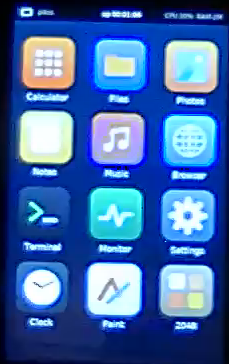
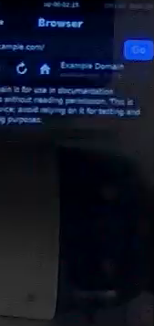

# p4os

A from-scratch operating system for the **ESP32-P4**, written entirely in Rust: no ESP-IDF, no FreeRTOS, no esp-hal. It targets silicon **revision v1.x**, which esp-hal does not support, on the **Guition JC4880P443C** board (4.3" 480×800 MIPI-DSI touch screen, ESP32-C6 Wi-Fi co-processor).

Status: working on real hardware, under active development. Built as a learning and research project.

| Home screen (camera capture of the board) | Browser loading a page over Wi-Fi |
|---|---|
|  |  |

## What works on the board

| Area | State |
|---|---|
| Boot, clocks | Rust kernel boots from the ESP-IDF 2nd-stage bootloader; CPU raised to 360 MHz |
| Kernel | Preemptive priority scheduler, mutex/semaphore, lazy FP context switch, dedicated interrupt stack, CLIC interrupt controller |
| User mode | Apps loaded from flash run in RISC-V U-mode, confined by PMP; syscalls for console, sleep, time; a faulting app is killed, the kernel keeps running |
| Memory | 32 MiB PSRAM at 200 MHz with DQS timing tuning; SRAM + PSRAM heaps |
| Display | MIPI-DSI ST7701S 480×800 via DSI bridge + DW-GDMA, double-buffered page flip, PWM backlight |
| Input | GT911 touch over I2C (axis calibration still to verify), USB console keys |
| Storage | SDMMC with IDMAC, FAT32 with long file names (rust-fatfs) |
| Audio | I2S + ES8311 codec + DMA ring (verified electrically; no speaker fitted) |
| Network | ESP32-C6 over SDIO running ESP-Hosted v2: Wi-Fi STA, DHCP, DNS, SNTP, TCP and HTTP/1.0 via smoltcp; HTTPS with TLS 1.3/1.2 (rustls + RustCrypto, certificates verified against the Mozilla roots) |
| GUI | Immediate-mode toolkit with anti-aliased fonts (Vietnamese included), on-screen keyboard, portrait/landscape, lock screen with a PBKDF2-hashed passcode and attempt limiting |
| Apps | Calculator, Files, Photos, Notes, Music, Browser, Terminal, Monitor, Settings, Clock, Paint, 2048, YouTube (Data API browsing and Google sign-in; no on-device playback yet) |

Not yet: loading user apps from SD, BLE, PPA graphics acceleration.

## Layout

| Path | Contents |
|---|---|
| `kernel/` | The OS: boot, traps, scheduler, drivers, services (`no_std`) |
| `gui/` | Canvas, fonts, immediate-mode widgets (`no_std` + `alloc`) |
| `sdk/` | The app interface: `App`, `System`, files, audio, network |
| `apps/` | Desktop shell and built-in apps |
| `abi/` | User-mode ABI: syscall numbers and the app image format |
| `userapps/` | Isolated user-mode apps and their runtime (`p4os-user`), built by `scripts/build-userapps.sh` |
| `media/` | JPEG/BMP and MP3/WAV decoding |
| `mem/` | `memcpy`/`memmove`/`memset`/`memcmp` for the kernel, replacing the slower `compiler_builtins` versions; host-tested |
| `net/` | Transport-independent HTTP/1.0, SNTP and TLS client logic shared by the kernel and the simulator |
| `sim/` | Host simulator: runs the desktop on Linux and writes PNG screenshots |
| `scripts/` | Build, flash, serial console, JTAG register dumps, camera-based test tools |
| `docs/` | Setup and hardware notes (Vietnamese): [getting-started.md](getting-started.md) |
| `plans/` | Design plans and research reports |

## Quick start

```sh
scripts/flash.sh                       # build the kernel and flash it to the factory partition
python3 scripts/monitor.py             # reset and watch the console
cargo sim -- "launch calculator; shot out/calc.png"   # run apps on the host
cargo test -p p4os-apps -p p4os-gui --target aarch64-unknown-linux-gnu
```

Requires Rust stable with the `riscv32imafc-unknown-none-elf` target, `esptool` and `pyserial`. Details, board pitfalls and recovery steps are in [getting-started.md](getting-started.md).

## Licence

Dual-licensed under MIT or Apache-2.0, at your option.
