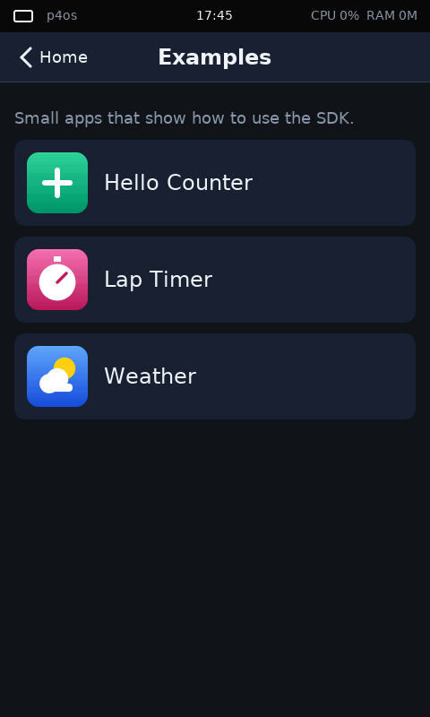
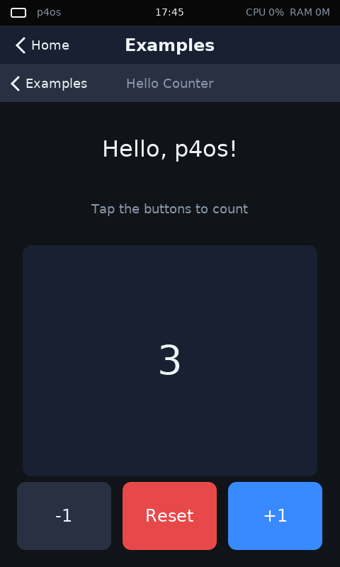
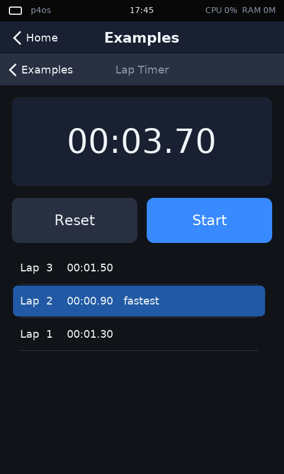
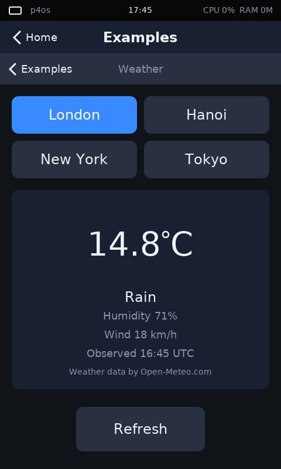
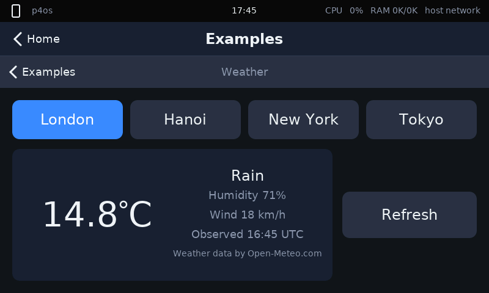
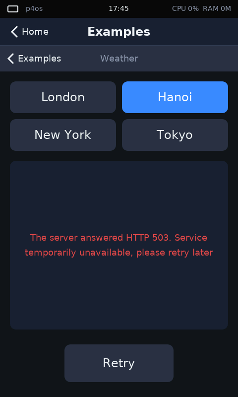

# Building apps for p4os

> **Tóm tắt (tiếng Việt).** p4os có hai loại app.
> **App tích hợp** (tin cậy) là crate Rust trong `apps/`, được link vào kernel, vẽ bằng bộ widget immediate-mode và dùng dịch vụ hệ thống qua trait `System` (file trên SD, cài đặt lưu trong flash, HTTP/HTTPS, đồng hồ, âm thanh, xoay màn hình). Chúng được test trên máy host và chụp màn hình bằng simulator.
> **App user** (không tin cậy) là binary riêng chạy ở U-mode trên core 1, bị PMP cách ly. Chúng chỉ có 6 syscall (in ra console, ngủ, đọc thời gian, yield, getpid, exit), không có GUI, được nạp vào slot flash bằng `scripts/flash-app.sh` và chạy bằng lệnh shell `run SLOT`.
> Bốn app mẫu: `apps/src/examples/` (Hello Counter, Lap Timer, Weather, mở từ biểu tượng **Examples**) và `userapps/ticker/`. Phần cuối có bảng tra cứu API và các API sắp có.

This guide shows how to write apps for p4os. It is based on the code on `main`; file paths are relative to the repository root.

- [Two kinds of app](#two-kinds-of-app)
- [Run the examples](#run-the-examples)
- [Built-in apps](#built-in-apps)
- [User-mode apps](#user-mode-apps)
- [Best practices](#best-practices)
- [API quick reference](#api-quick-reference)
- [Coming soon](#coming-soon)

## Two kinds of app

| | Built-in app | User-mode app |
|---|---|---|
| Trust | Trusted: runs in the kernel's address space (M-mode) | Untrusted: RISC-V U-mode, confined by PMP to its own memory |
| Where the code lives | A module in `apps/src/`, linked into the kernel image | Its own crate in `userapps/`, packed into a `.p4app` image in a flash slot |
| What it can do | Draw the UI, touch and keyboard input, files, settings, HTTP/HTTPS, audio, images, clock | Print to the console, sleep, read the uptime, yield, get its id, exit |
| Runs on | The `gui` thread (either core) | Core 1, one thread per app |
| Start it | Tap its icon in the launcher | Shell: `run SLOT [ARG]` |
| Test without a board | Host unit tests and the simulator | Not yet (needs the board) |

Most apps today are built-in apps. User-mode apps are the start of a safe app model: the kernel survives anything they do (with one hardware exception, see [Isolation](#isolation-guarantees-and-known-limits)), but they cannot draw yet.

## Run the examples

The examples are in [`apps/src/examples/`](../apps/src/examples/) and open from the **Examples** icon on the home screen:

| Examples folder | Hello Counter | Lap Timer | Weather |
|---|---|---|---|
|  |  |  |  |

| Example | Shows |
|---|---|
| [`hello.rs`](../apps/src/examples/hello.rs) | `AppInfo`, the `App` trait, layout from `area`, buttons, keyboard keys, portrait and landscape |
| [`lap_timer.rs`](../apps/src/examples/lap_timer.rs) | `uptime_ms`, ticking only while needed, settings that survive a reboot, a scrolling list |
| [`weather.rs`](../apps/src/examples/weather.rs) | HTTPS fetch and poll, error handling, reading JSON, remembering a choice |
| [`userapps/ticker`](../userapps/ticker/src/main.rs) | A user-mode app using every syscall, including an error return |

The examples sit behind one launcher icon, not one icon each, so that they build and are tested with the rest of the workspace (no feature flag to forget) without crowding the home screen. The folder is itself an app ([`examples/mod.rs`](../apps/src/examples/mod.rs)) that hosts the example you pick. Adding an example takes one entry in its `EXAMPLES` list.

Run them in the simulator (on an aarch64 Linux host; see [Simulator](#simulator) for other hosts):

```sh
cargo sim "launch examples; shot /tmp/folder.png; tap 240 204; shot /tmp/hello.png"
```

## Built-in apps

### Anatomy of an app

An app is a type that implements `App`, plus a constant `AppInfo` that tells the launcher its id, name, icon and how to create it. This is the start of [`hello.rs`](../apps/src/examples/hello.rs):

```rust
use alloc::boxed::Box;
use alloc::format;
use p4os_sdk::gui::ui::{Align, Key};
use p4os_sdk::{App, AppInfo, Canvas, Color, Rect, System, Ui};

/// What the launcher (here: the Examples folder) needs to know.
pub const INFO: AppInfo = AppInfo { id: "example-hello", name: "Hello Counter", icon, create };

fn create() -> Box<dyn App> {
    Box::new(Hello::default())
}

/// Icons are drawn with canvas primitives at any size.
fn icon(c: &mut Canvas, r: Rect) {
    crate::icons::tile(c, r, Color::hex(0x34d399), Color::hex(0x059669));
    let m = r.center();
    let bar = (r.w / 10).max(2);
    let len = r.w / 2;
    c.fill_round_rect(Rect::new(m.x - len / 2, m.y - bar / 2, len, bar), bar / 2, Color::WHITE);
    c.fill_round_rect(Rect::new(m.x - bar / 2, m.y - len / 2, bar, len), bar / 2, Color::WHITE);
}

/// Everything the app remembers between frames.
#[derive(Default)]
struct Hello {
    count: Counter,
}
```

The crate is `no_std` with `alloc`: use `alloc::{string::String, vec::Vec, format!}` instead of `std`, and `libm` for maths functions such as `sinf`.

The `App` trait has three methods ([`sdk/src/lib.rs`](../sdk/src/lib.rs)):

```rust
pub trait App {
    /// Draw the app into `area` and react to this frame's input.
    fn update(&mut self, ui: &mut Ui, area: Rect, sys: &mut dyn System);

    /// Ask to be updated periodically even without input (animations,
    /// clocks, playback position). `None` means only on input.
    fn tick_interval_ms(&self) -> Option<u32> {
        None
    }

    /// Called when the user leaves the app; release audio, etc.
    fn on_close(&mut self, _sys: &mut dyn System) {}
}
```

### The frame loop

The desktop ([`apps/src/desktop.rs`](../apps/src/desktop.rs)) owns the screen. It draws the status bar and a title bar with a **Home** button, and gives the rest of the screen to the running app as `area`. A frame is drawn:

- when there is input (touch or a key);
- when the interval returned by `tick_interval_ms` has passed;
- at least once a second anyway, because the status bar clock is redrawn;
- immediately again after any tap or key, because immediate-mode widgets react while they draw, so a change made by a tap only shows in the next frame.

Each frame, `update` must draw the whole app: there is no retained widget tree. On the board `update` runs on the kernel's `gui` thread (priority 3, 48 KiB stack), and nothing else is drawn or handles touch while it runs. So `update` must return quickly; see [No blocking in a frame](#no-blocking-in-a-frame).

`update` is never called concurrently with itself. The app object is created when the user opens the app and dropped when they leave (Home button or Escape key) after `on_close`. State that must outlive that goes into [settings](#settings) or a [file](#files).

### Layout

All layout is computed from `area` each frame, with the helpers on `Rect` ([`gui/src/geom.rs`](../gui/src/geom.rs)): `inset`, `split_top`, `split_left`, `grid_cell`, `center`, `contains`, `intersect`. Never hard-code the screen size: `area` is about 480 x 708 in portrait and 800 x 388 in landscape (the status and title bars take the rest), and it is smaller while the on-screen keyboard is open.

From `hello.rs`:

```rust
        // Layout: a text block on top and a row of buttons below it. In
        // landscape the screen is wider than tall, so the buttons get less
        // height and the text block more width; the code is the same.
        let inner = area.inset(24);
        let buttons_h = 96;
        let (top, bottom) = inner.split_top(inner.h - buttons_h);
        let (greeting, number) = top.split_top(top.h / 3);
```

When the layout should change shape, compare the sides, as `weather.rs` does to put its city buttons in one row in landscape and a 2 x 2 grid in portrait:

```rust
        let landscape = inner.w > inner.h;
        let (chips, rest) = inner.split_top(if landscape { 64 } else { 140 });
        let (cols, rows) = if landscape { (4, 1) } else { (2, 2) };
```

In landscape it also moves the Refresh button beside the card, since the screen is too low to stack them:



The user rotates the screen from the status bar. An app can also read and request it with `sys.orientation()` and `sys.set_orientation(o)`; the change takes effect on the next frame and is saved.

### Widgets and drawing

`Ui` ([`gui/src/ui.rs`](../gui/src/ui.rs)) bundles the canvas, this frame's input, the theme, the fonts and the widget state. Widgets take the rectangle they occupy and return what happened this frame. A widget's identity is its rectangle, so keep rectangles stable between frames (they are, when computed from `area`).

```rust
        // Widgets return true on the frame they are tapped.
        if ui.button(bottom.grid_cell(3, 1, 16, 0, 0), "-1") {
            self.count.add(-1);
        }
        if ui.button_colored(bottom.grid_cell(3, 1, 16, 1, 0), "Reset", t.danger, Color::WHITE) {
            self.count.reset();
        }
        if ui.button_primary(bottom.grid_cell(3, 1, 16, 2, 0), "+1") {
            self.count.add(1);
        }
```

| Widget | Returns |
|---|---|
| `button`, `button_primary`, `button_colored(r, label, bg, fg)` | `true` when tapped |
| `icon_button(r, \|canvas, rect, color\| ...)` | `true` when tapped; you draw the face |
| `toggle(r, &mut bool)` | `true` when flipped |
| `slider(r, &mut f32)` | `true` while the value (0..=1) changes |
| `progress(r, value)` | draws a bar |
| `text_field(r, &mut String, placeholder)`, `password_field(...)` | `true` when Enter is pressed |
| `list(r, &rows, row_h, &mut offset, selected)` | the index of a tapped row; drag to scroll |
| `scroll(r, content_h, &mut offset)` | the clamped offset, for your own scrolling content |
| `interact(r)` | `(held, clicked)` for custom widgets |
| `text(r, s, &font, color, Align)`, `label(r, s)`, `panel(r)`, `fill(r, color)` | drawing helpers |

Text fields open the on-screen keyboard automatically: a focused field sets `ui.state.wants_keyboard`, and the desktop shrinks `area` and shows the keyboard below it.

For anything else draw on `ui.canvas` ([`gui/src/canvas.rs`](../gui/src/canvas.rs)): `fill_rect`, `fill_rect_alpha`, `fill_gradient`, `fill_round_rect`, `stroke_round_rect`, `fill_circle`, `stroke_circle`, `line` (anti-aliased, any width), `fill_triangle`, `blit` and `blit_scaled` for images. Use `set_clip`/`restore_clip` to keep drawing inside a rectangle.

**Text.** `ui.fonts` has `small` (14 px), `body` (18), `large` (24), `title` (32), `bold` (24), `huge` (56) and `mono` (16), all anti-aliased with Latin and Vietnamese glyphs. `font.measure(s)` gives the width and `font.wrap(s, width)` breaks text into lines (see the error message in `weather.rs`).

**Colours and theme.** Colours are RGB565: `Color::hex(0x3d8bfd)`, `Color::rgb(r, g, b)`, `.lighten(n)`, `.darken(n)`, `.blend(bg, alpha)`. Use the theme (`ui.theme`: `bg`, `surface`, `surface_alt`, `text`, `text_dim`, `accent`, `accent_text`, `danger`, `border`, `radius`) rather than fixed colours so apps look consistent. Copy it out first, because widget calls borrow `ui` mutably: `let t = *ui.theme;`.

**Images.** `sys.decode_image(&bytes, max_w, max_h)` decodes JPEG or BMP, scaled down to fit, into an `Image` you can `blit`. See [`apps/src/photos.rs`](../apps/src/photos.rs).

### Input

`ui.input` holds this frame's input: `pos`, `down`, `pressed` (touch started), `released` (touch ended), `press_pos`, `delta` (movement while touching), `is_drag()`, `tapped_in(rect)`, and `keys` (characters, Enter, Backspace, arrows, Escape from the on-screen or USB keyboard). Widgets already handle taps; read `ui.input` for gestures such as swipes ([`apps/src/game2048.rs`](../apps/src/game2048.rs)) or keys:

```rust
        // A hardware or USB keyboard works too: + and - change the count.
        for key in ui.input.keys.clone() {
            match key {
                Key::Char('+') | Key::Up => self.count.add(1),
                Key::Char('-') | Key::Down => self.count.add(-1),
                _ => {}
            }
        }
```

Escape is taken by the desktop and returns to the home screen.

### System services

`sys: &mut dyn System` is the app's door to the OS. The full list is in the [API quick reference](#api-quick-reference); the most used services follow.

#### Time

- `sys.uptime_ms()`: milliseconds since boot. Monotonic; use it for all timing.
- `sys.now()`: wall-clock `DateTime` in **UTC**, or `None` until it is known (set by SNTP after Wi-Fi connects, or by the user in Settings). Never assume it is set.

To animate or count, return an interval from `tick_interval_ms`, and only while something changes. From `lap_timer.rs`:

```rust
    fn tick_interval_ms(&self) -> Option<u32> {
        // No ticks while stopped: the app then only redraws on input.
        self.watch.is_running().then_some(TICK_MS)
    }
```

#### Settings

`sys.config_get(key)` and `sys.config_set(key, value)` store small strings in SPI flash; they survive reboots and power loss (two alternating sectors with CRC, format in [`sdk/src/config.rs`](../sdk/src/config.rs)). Rules:

- Keys are printable ASCII without spaces, at most 32 bytes; values at most 255 bytes. Entries that break the rules are refused (and logged on the console).
- All settings of all apps share one 4 KiB record. Store a few short values, not data.
- Prefix keys with your app id. `wifi.*`, `ui.*` and `lock.*` belong to the OS and `youtube.*` to the YouTube app. `wifi.password` is write-only and reads back as `None`; the shell masks secrets such as tokens in `config list`.
- `sys.config_remove(key)` deletes a key (the Lap Timer's Reset does this).
- Each `config_set` that changes a value erases and writes a flash sector, which blocks the GUI for tens of milliseconds and wears the flash. Save on a user action, never every frame. Setting an unchanged value writes nothing.
- Values can be anything (an older app version, a value typed in the shell). Parse defensively.

From `lap_timer.rs`:

```rust
/// Settings key. Apps may store their own keys: printable ASCII without
/// spaces, at most 32 bytes; values at most 255 bytes. Prefix keys with the
/// app id so they cannot clash with OS keys (`wifi.*`, `ui.*`, `lock.*`).
pub const LAPS_KEY: &str = "example-laps.laps";
```

```rust
    fn save(&self, sys: &mut dyn System) {
        // config_set writes a flash sector (tens of milliseconds), so it is
        // called on a button press, never every frame.
        sys.config_set(LAPS_KEY, &encode_laps(&self.watch.laps));
    }
```

`System` is only available inside `update`, so load settings on the first frame:

```rust
        if !self.loaded {
            self.loaded = true;
            self.watch.laps = decode_laps(&sys.config_get(LAPS_KEY).unwrap_or_default());
        }
```

The shell command `config list` prints all keys (secrets masked).

#### Files

`sys.fs()` is a FAT32 file system on the SD card, mounted at `/sd`. Paths are absolute and `/`-separated. The standard folders (created by `format sd`) are `Music`, `Pictures`, `Documents`, `Notes`, `Paint`, `Apps` and `p4os`.

- `read(path)` and `write(path, data)` move whole files; `write` replaces the file.
- `open(path)` returns a `FileReader` for streaming large files (music).
- `list(path)`, `create_dir(path)`, `remove(path)`.
- Errors are `FsError::{NotFound, NotADirectory, NoMedium, Io, Unsupported}`. `NoMedium` means no card: handle it, the board often runs without one.

[`apps/src/game2048.rs`](../apps/src/game2048.rs) keeps its best score in a file and ignores a missing card:

```rust
    /// Persist the best score if it improved; a missing card is ignored.
    fn save_best(&mut self, sys: &mut dyn System) {
        if self.best > self.saved_best && sys.fs().write(BEST_PATH, format!("{}\n", self.best).as_bytes()).is_ok() {
            self.saved_best = self.best;
        }
    }
```

Use settings for a few short values that must always be there, and files for anything larger. File calls are synchronous; reading a few KiB is fine in a frame, a large file is not (see [Notes](../apps/src/notes.rs) for reading only the head of each file in a list).

#### Network (HTTP and HTTPS)

`sys.net()` gives the `Network`:

- `is_up()` is true once Wi-Fi has an IP address; `status()` is a short human-readable state.
- `fetch(url)` starts an HTTP GET in the background and returns a `FetchId` at once. `http://` and `https://` work; HTTPS certificates are verified against the Mozilla roots, so the clock must be set (it is, a few seconds after Wi-Fi connects).
- `send(HttpRequest)` starts any other request (a method, extra headers, a body of at most 2 KiB) and is polled the same way. Build one with `HttpRequest::get(url)` or `HttpRequest::post_form(url, body)` and add headers with `.header(name, value)`. The OS writes Host, User-Agent, Accept-Encoding, Connection and Content-Length itself; a request that repeats them or has control characters in a header fails. An `Authorization` header is dropped when a redirect leads to another origin.
- `poll(id)` returns `FetchState::Pending`, `Done { status, content_type, body }` or `Failed(message)`. The OS gives up after 30 seconds and reports `Failed`. Redirects are followed.
- A finished result is handed out **once** and then forgotten. Store it in your app state.
- `cancel(id)` abandons a request you no longer need (the user picked something else, or the app is closing). Otherwise the OS keeps its result until it is polled.
- Responses are read whole into RAM; there is no streaming.

The pattern from `weather.rs`: start the request, poll it every frame, tick only while it is in flight, and cancel what is no longer wanted.

```rust
    fn request(&mut self, sys: &mut dyn System) {
        // One request at a time. A request that is no longer wanted is
        // cancelled: otherwise the OS would keep its result until polled.
        self.cancel(sys);
        self.load = if sys.net().is_up() {
            Load::Waiting(sys.net().fetch(&forecast_url(&CITIES[self.city])))
        } else {
            Load::Failed("No network. Join a Wi-Fi network in Settings, then tap Retry.".into())
        };
    }

    fn cancel(&mut self, sys: &mut dyn System) {
        if let Load::Waiting(id) = self.load {
            sys.net().cancel(id);
            self.load = Load::Idle;
        }
    }

    /// Check on the request in flight; never waits.
    fn poll(&mut self, sys: &mut dyn System) {
        let Load::Waiting(id) = self.load else { return };
        self.load = match sys.net().poll(id) {
            FetchState::Pending => return,
            FetchState::Done { status, body, .. } => match parse_weather(status, &body) {
                Ok(w) => Load::Ready(w),
                Err(msg) => Load::Failed(msg),
            },
            // The OS reports DNS, TLS and timeout failures (a request gives
            // up after 30 s) here as text.
            FetchState::Failed(msg) => Load::Failed(format!("Could not reach the weather service: {}", msg)),
        };
    }
```

```rust
    fn tick_interval_ms(&self) -> Option<u32> {
        // Poll a few times a second while waiting; otherwise sleep until
        // the user touches something.
        matches!(self.load, Load::Waiting(_)).then_some(250)
    }

    fn on_close(&mut self, sys: &mut dyn System) {
        // Leaving while a request is in flight: tell the OS to drop it.
        self.cancel(sys);
    }
```

Every failure becomes a message with a Retry button, here an HTTP 503 answered by a simulator fixture:



The YouTube app ([`apps/src/youtube/`](../apps/src/youtube/mod.rs)) shows the rest of the API: an OAuth device-flow sign-in with `post_form`, bearer tokens with `.header("Authorization", ...)`, and a validating, allocation-free JSON reader in [`json.rs`](../apps/src/youtube/json.rs). There is no JSON crate in the workspace; `weather.rs` has a small, tested `json_field` helper that is enough for a few fields of a well-formed response. A TLS handshake takes 0.25 to 1.6 s on the board, so show a loading state.

#### Audio

`sys.audio().play(source)` plays a `Box<dyn AudioSource>` on the OS audio thread: implement `sample_rate()` and `fill(&mut [i16])` with interleaved stereo samples, returning 0 at the end. `pause`, `stop`, `state`, `position_frames`, `set_volume` control playback. Audio keeps playing when your app is closed unless you stop it in `on_close`. See [`apps/src/music.rs`](../apps/src/music.rs), which decodes MP3 and WAV with `p4os-media`. (The board's speaker output works electrically but no speaker is fitted on the test board.)

#### Other services

| Call | Use |
|---|---|
| `sys.stats()` | Uptime, CPU load per core, SRAM and PSRAM use, thread list ([Monitor](../apps/src/monitor.rs)) |
| `sys.brightness()`, `sys.set_brightness(v)` | Backlight 0..=1; saved after the slider settles |
| `sys.wifi_connect(ssid, password)` | Join a network in the background and remember it |
| `sys.fill_random(buf)` | Bytes from the hardware RNG; returns `false` when no secure source exists, and then you must refuse, not fall back |
| `sys.launch(app_id)` | Switch to another app |
| `sys.run_command(line)` | Run a shell command and capture its output ([Terminal](../apps/src/terminal.rs)) |
| `sys.lock_now()` | Lock the screen if a passcode is set |
| `sys.set_time(t)` | Set the wall clock (UTC) |

### Register the app

Add the module to [`apps/src/lib.rs`](../apps/src/lib.rs) and its `INFO` to `APPS`. The launcher shows apps in that order:

```rust
pub mod game2048;
pub mod examples;
```

```rust
pub static APPS: &[AppInfo] = &[
    calculator::INFO,
    // ...
    game2048::INFO,
    examples::INFO,
];
```

Ids must be unique; the launcher, the simulator's `launch` command and `sys.launch` use them. For a demo or experiment, add it to `EXAMPLES` in [`apps/src/examples/mod.rs`](../apps/src/examples/mod.rs) instead, so it appears inside the Examples folder.

### Test on the host

Keep logic in plain functions and types without drawing, and unit-test them on the host. The host target must be given explicitly because the workspace default is the board:

```sh
cargo test -p p4os-apps -p p4os-gui -p p4os-net -p p4os-sdk --target aarch64-unknown-linux-gnu
```

(Use your host's target triple, e.g. `x86_64-unknown-linux-gnu`, on a PC.)

To test `update` itself, [`apps/src/examples/testkit.rs`](../apps/src/examples/testkit.rs) has a `Harness` that renders frames into a RAM canvas and feeds taps, with an in-memory `TestSystem` (settings, files, a scripted network that hands out results once like the kernel, a clock the test moves). From `lap_timer.rs`:

```rust
    #[test]
    fn laps_persist_across_app_restarts() {
        let mut h = Harness::new();
        h.sys.uptime = 5_000;
        let mut app = LapTimer::default();
        h.frame(&mut app);
        let inner = Rect::new(20, 20, 440, 760);
        let buttons = Rect::new(20, 20 + 150 + 20, 440, 76);
        let (left, right) = (buttons.grid_cell(2, 1, 16, 0, 0).center(), buttons.grid_cell(2, 1, 16, 1, 0).center());
        assert!(inner.contains(left));

        h.tap(&mut app, right); // Start
        assert!(app.watch.is_running());
        assert_eq!(app.tick_interval_ms(), Some(TICK_MS));
        h.sys.uptime = 7_340;
        h.tap(&mut app, left); // Lap
        h.tap(&mut app, right); // Stop
        assert_eq!(app.tick_interval_ms(), None);
        assert_eq!(h.sys.config.get(LAPS_KEY).map(String::as_str), Some("2340"));
        assert_eq!(h.sys.config_writes, 1, "only the lap wrote to flash");
        // ...
    }
```

The harness renders the app over the whole 480 x 800 canvas (no status or title bar), so tap coordinates are relative to the app's own layout.

### Simulator

The simulator ([`sim/`](../sim/src/main.rs)) runs the real desktop and apps on Linux and writes PNG screenshots. Input comes from a script:

| Command | Effect |
|---|---|
| `launch APP_ID` | Open an app (home screen ids from `APPS`) |
| `tap X Y`, `drag X1 Y1 X2 Y2` | Touch, in screen coordinates (status bar included) |
| `type TEXT`, `key enter\|backspace\|esc\|up\|down\|left\|right` | Keyboard |
| `wait MS` | Let time pass, running requested ticks |
| `shot FILE.png` | Write a screenshot |
| `rotate` | Toggle portrait and landscape |
| `config KEY VALUE` | Store a setting |
| `mock URL_PART FILE [STATUS]` | Answer requests whose URL contains `URL_PART` with `FILE` (path from the repository root) instead of the network |
| `lock` | Lock the screen now |

Commands go on the command line separated by `;`, or one per line in a file passed with `--script FILE`. `--landscape` starts in landscape and `--sd DIR` picks the directory that stands in for the SD card (default `sim/sdcard`). Network requests really go out, over the host's network, through the same HTTP and TLS code as the board, unless a `mock` answers them; use mocks for screenshots and repeatable runs (the examples' fixtures are in [`sim/fixtures/examples/`](../sim/fixtures/examples/)). Settings last for one run only.

```sh
# on an aarch64 Linux host (the `cargo sim` alias in .cargo/config.toml)
cargo sim "launch examples; tap 240 204; tap 388 728; tap 388 728; shot /tmp/hello.png"
# on any other host, name its target instead of the board's
cargo run --release -p p4os-sim --target x86_64-unknown-linux-gnu -- "launch calculator; shot /tmp/calc.png"
```

The screenshots on this page were made with [`docs/screenshots/examples.sim`](screenshots/examples.sim).

### Build and flash

Built-in apps are part of the kernel image. With the board on `/dev/ttyACM0` (set `PORT` otherwise):

```sh
scripts/flash.sh               # build out/p4os.bin and write it to the factory partition (0x10000)
python3 scripts/monitor.py     # reset the board and show the console
```

Requirements, recovery and board details are in [getting-started.md](getting-started.md). When building inside a git worktree nested in the repository, cargo merges both `.cargo/config.toml` files and passes the linker script twice; build with `RUSTFLAGS="-C link-arg=-Tlink.x"` there.

## User-mode apps

A user-mode app is a separate `no_std`, `no_main` binary. The kernel loads it from a flash slot into fresh RAM and runs it in RISC-V U-mode on core 1, where PMP lets it reach only its own code, data and stack. Everything else goes through syscalls. The design is in [plans/261028-1217-user-mode-apps/design.md](../plans/261028-1217-user-mode-apps/design.md).

### Write one

1. Create `userapps/NAME/Cargo.toml`, depending on the runtime crate [`p4os-user`](../userapps/p4os-user/src/lib.rs) (entry point, syscall wrappers, `print!`/`println!`, panic handler):

   ```toml
   [package]
   name = "ticker"
   version = "0.1.0"
   edition = "2024"
   license = "MIT OR Apache-2.0"
   description = "p4os user-mode example: prints, sleeps, reads the time and checks syscall errors"

   [[bin]]
   name = "ticker"
   test = false
   bench = false

   [dependencies]
   p4os-user = { path = "../p4os-user" }
   ```

2. Write `src/main.rs`. `entry!` names the function the kernel calls with the `run` argument; its return value is the exit code. From [`userapps/ticker/src/main.rs`](../userapps/ticker/src/main.rs):

   ```rust
   #![no_std]
   #![no_main]

   use p4os_user::{err, exit, getpid, println, sleep_ms, uptime_ms, write, yield_now};

   // The kernel enters `_start` (in p4os-user), which calls this function with
   // the `run` argument and exits with its return value.
   p4os_user::entry!(main);

   const PERIOD_MS: u32 = 500;
   const DEFAULT_TICKS: u32 = 5;
   const MAX_TICKS: u32 = 60;

   fn main(arg: u32) -> i32 {
       // Validate input at the boundary: the argument comes from whoever typed
       // the `run` command.
       let ticks = match arg {
           0 => DEFAULT_TICKS,
           n => n.min(MAX_TICKS),
       };
       println!("ticker: pid {}, {} ticks every {} ms", getpid(), ticks, PERIOD_MS);
       // ... sleeps, prints each tick, then:

       // Syscalls report errors as negative return values (`p4os_abi::err`).
       // There is no file descriptor 2, so this fails with EBADF.
       let r = write(2, b"to stderr?\n");
       if r == err::EBADF {
           println!("ticker: write to fd 2 failed with EBADF, as documented");
       } else {
           println!("ticker: unexpected result {} from write to fd 2", r);
           exit(1);
       }

       // Give other threads a turn before finishing.
       yield_now();
       println!("ticker: done");
       0
   }
   ```

3. Register it: add `"NAME"` to `members` in [`userapps/Cargo.toml`](../userapps/Cargo.toml) and to `APPS=(...)` in [`scripts/build-userapps.sh`](../scripts/build-userapps.sh).

`userapps/` is its own workspace (excluded from the main one) because it builds position-independent executables with its own linker script.

### Build, flash, run

```sh
scripts/build-userapps.sh                         # -> out/userapps/{hello,crash,ticker}.p4app
scripts/flash-app.sh 2 out/userapps/ticker.p4app  # write slot 2 (takes the board lock)
```

`build-userapps.sh` compiles for `riscv32imafc-unknown-none-elf` with `-C relocation-model=pie` and packs each ELF with [`scripts/mkapp.py`](../scripts/mkapp.py), which checks the layout rules and prints the image size. `flash-app.sh SLOT IMAGE` writes only the 64 KiB slot at `0x720000 + SLOT * 0x10000` (slots 0..13); it refuses files that are not app images or are too large.

Then on the serial console (`python3 scripts/monitor.py`, or the Terminal app):

```text
apps            list valid slots: name, image size, RAM needed
run 2           run slot 2 with argument 0 and wait until it ends
run 2 10        the same with argument 10
```

The kernel logs where the app runs, everything it prints, and how it ended:

```text
p4os> run 13
app 'ticker': core 1, 12544 bytes RAM at 0x4ff32b00
ticker: pid 7, 5 ticks every 500 ms
tick  1 at   500 ms (+0 ms)
tick  2 at  1000 ms (+0 ms)
tick  3 at  1500 ms (+0 ms)
tick  4 at  2000 ms (+0 ms)
tick  5 at  2500 ms (+0 ms)
ticker: worst wake-up delay 0 ms
ticker: write to fd 2 failed with EBADF, as documented
ticker: done
app 'ticker' (thread 7) exited with code 0
```

(Captured on the board with the app in slot 13. Other kernel log lines, such as Wi-Fi events, can appear in between.)

A fault ends only the app: `*** app 'NAME' (thread N) killed: store access fault at pc=... (app+0x74), mtval=...`.

### Syscalls

`ecall` with the number in `a7`, arguments in `a0..a5`, result in `a0`; negative results are errors. Defined in [`abi/src/lib.rs`](../abi/src/lib.rs), served by [`kernel/src/syscall.rs`](../kernel/src/syscall.rs).

| `a7` | Call | `p4os-user` wrapper | Result |
|---|---|---|---|
| 0 | exit(code) | `exit(code) -> !`, or return from `main` | does not return |
| 1 | write(fd, ptr, len) | `write(fd, &[u8]) -> i32`, `print!`, `println!` | bytes written; `EBADF` (-9) unless fd is 1 (console); `EFAULT` (-14) if the buffer is not in the app's memory |
| 2 | sleep_ms(ms) | `sleep_ms(ms)` | 0 |
| 3 | uptime_ms() | `uptime_ms() -> u32` | ms since boot, wraps after about 49 days |
| 4 | yield() | `yield_now()` | 0 |
| 5 | getpid() | `getpid() -> u32` | kernel thread id |
| other | | `raw_syscall(n, a0, a1, a2)` | `ENOSYS` (-38) |

A panic prints `panic: ...` and exits with code 101 (`PANIC_EXIT`).

### Limits

| Limit | Value | Where |
|---|---|---|
| Image size in flash | 64 KiB per slot, header included | `p4os_abi::SLOT_SIZE` |
| Slots | 14 (0..13) | `kernel/src/apploader.rs` |
| RAM per app (image + bss + stack) | at most 256 KiB, allocated from the kernel heap when the app starts | `p4os_abi::MAX_APP_MEM` |
| Stack | 8 KiB (set by `STACK_SIZE` in the linker script; minimum 1 KiB) | [`userapps/p4os-user/link.x`](../userapps/p4os-user/link.x) |
| Alignment | code end, memory end and stack size are multiples of 128 bytes (the PMP granule) | `p4os_abi::REGION_ALIGN` |
| Argument | one `u32` | |
| Heap | none: no `alloc`, use fixed-size buffers | |
| Not available | display, touch, files, network, settings, wall clock; killing a running app from the shell; loading from SD | design note, "Not yet" |

The hello app is about 25 KiB because of `f32` formatting; `ticker` is about 4 KiB.

### Isolation guarantees and known limits

What the kernel guarantees, measured on the board with [`userapps/crash`](../userapps/crash/src/main.rs) (`run SLOT N`, N = 0..9):

- The app can read and execute its code, and read and write its data and stack. Nothing else: kernel SRAM, kernel code and read-only data in flash, peripherals, the cache controller and the ROM all raise an access fault, and the kernel kills only that app.
- The app cannot write its own code.
- Syscalls check every pointer against the app's own memory before use (`EFAULT`).
- Apps are preempted like other threads; a busy loop does not stop the system.

Known limits:

- **Core 1 can hang.** A U-mode access to the CPU subsystem window `0x2000_0000..0x3000_0000` (CLIC, debug) is denied but raises no exception: core 1 stalls until reset. The app cannot read or change the interrupt controller, but it can take core 1 down (`crash` test 7). Do not run that test on a shared board. Fixing it needs a core-1 watchdog; not done yet.
- Apps run on core 1 because the ESP-IDF bootloader leaves PMP entries locked on core 0 that would let U-mode reach the CLIC, cache controller and ROM. If core 1 were unusable, the kernel would fall back to core 0 with that exposure (shell `pmp` shows the state).
- There is no way to stop a running app other than waiting for it to end or resetting the board.

## Best practices

### No blocking in a frame

`update` runs on the GUI thread. While it runs, nothing is drawn and no touch is handled. Keep each frame to a few milliseconds:

- Network: `fetch` then `poll`, never wait in a loop (the API cannot block anyway).
- Ticks: ask for them only while something changes (`lap_timer.rs`, `weather.rs`). An idle app with `tick_interval_ms() == None` costs nothing.
- Files: reading or writing a small file is fine; for big files read a part per frame or use `open` and a `FileReader` from a background source (audio does this).
- Settings: `config_set` blocks for a flash erase and write; only on user actions.
- Heavy computation (a long PBKDF2, decoding a big image): show a progress state first, then do it in the next frame, as the lock screen does for its passcode check (`apps/src/lock/`).

### Memory budget: SRAM and PSRAM

The board has a few hundred KiB of internal SRAM for the heap and 32 MiB of PSRAM. The kernel heap ([`kernel/src/heap.rs`](../kernel/src/heap.rs)) places allocations below 64 KiB in SRAM first and larger ones in PSRAM first, falling back to the other when full. Apps use the normal `alloc` types; the placement is automatic. What this means for app code:

- SRAM is fast but scarce, and thread stacks and network buffers live there. Avoid keeping thousands of small allocations alive (long `Vec<String>` of lines); prefer one large buffer.
- PSRAM is plentiful but slower (about 56 MB/s for copies, against more than 600 MB/s in SRAM). Images, audio buffers and HTTP bodies land there because they are large.
- Free what you do not need: drop decoded images when they go off screen and response bodies once parsed. The status bar and the Monitor app show RAM use; the shell `mem` command shows peaks.
- An HTTPS request uses about 45 KB of SRAM at its peak while it runs.

### No allocation in interrupt context (kernel code)

App code never runs in interrupt context, but if you work on drivers: the heap must not be used from interrupt handlers. Every heap entry point checks the stack pointer and panics with `heap used from interrupt context`. Do the work in a thread and signal it from the handler with `sched::notify`.

Interrupt levels 1 to 3 are kernel levels: their handlers may take spinlocks and signal semaphores, and kernel critical sections mask them by raising the CLIC threshold. Levels 4 to 7 (display page flip, audio DMA) keep running inside those critical sections, so their handlers must not take any lock or allocate; they may only touch registers and atomics and call `sched::notify`. Details are in [getting-started.md](getting-started.md) (in Vietnamese).

### Persist settings carefully

- Settings for small values, files for data. Prefix keys with your app id.
- Write only when the value changed and only on user actions.
- Parse stored values defensively and fall back to defaults (`decode_laps`, the city index in `weather.rs`).
- Expect the SD card to be missing (`FsError::NoMedium`).

### Handle network errors

- Check `is_up()` first and tell the user how to fix it ("Join a Wi-Fi network in Settings").
- Handle all three outcomes: `Failed(message)` (DNS, TLS, timeout), `Done` with a status other than 200, and a 200 whose body is not what you expected.
- Offer a Retry button rather than retrying in a loop.
- Keep one request per purpose in flight, and `cancel` the ones you no longer need (a new choice, `on_close`): the OS holds each result until it is polled once or cancelled.

### Keep secrets out of logs

- Never print passwords, tokens or passcodes with `kprintln!`, `println!` or on screen. The serial console is often captured.
- Do not put secrets in URLs: URLs appear in error messages.
- Use `password_field` for secret input.
- Store only what you must. `wifi.password` is write-only for apps, and the lock screen stores a salted PBKDF2 hash, never the passcode ([`apps/src/lock/pin.rs`](../apps/src/lock/pin.rs)).
- Use `fill_random` for salts and keys, and refuse the operation if it returns `false`.

## API quick reference

The `p4os-sdk` traits, from [`sdk/src/lib.rs`](../sdk/src/lib.rs). Methods with a default body do nothing (or return `None`/`false`) on systems that do not implement them.

### `App`

| Method | Purpose |
|---|---|
| `fn update(&mut self, ui: &mut Ui, area: Rect, sys: &mut dyn System)` | Draw and handle input for one frame |
| `fn tick_interval_ms(&self) -> Option<u32>` | Redraw interval without input; default `None` |
| `fn on_close(&mut self, sys: &mut dyn System)` | The user left the app; default does nothing |

`AppInfo { id: &'static str, name: &'static str, icon: fn(&mut Canvas, Rect), create: fn() -> Box<dyn App> }`

### `System`

| Method | Purpose |
|---|---|
| `fn uptime_ms(&self) -> u64` | Milliseconds since boot |
| `fn now(&self) -> Option<DateTime>` | Wall clock (UTC) when known |
| `fn set_time(&mut self, t: DateTime)` | Set the wall clock |
| `fn fs(&mut self) -> &mut dyn FileSystem` | SD card |
| `fn audio(&mut self) -> &mut dyn Audio` | Audio output |
| `fn net(&mut self) -> &mut dyn Network` | HTTP/HTTPS |
| `fn stats(&self) -> SystemStats` | CPU, memory, threads |
| `fn decode_image(&mut self, data: &[u8], max_w: i32, max_h: i32) -> Option<Image>` | JPEG/BMP to pixels, scaled to fit |
| `fn brightness(&self) -> f32` / `fn set_brightness(&mut self, value: f32)` | Backlight 0..=1 |
| `fn run_command(&mut self, line: &str) -> String` | Shell command output |
| `fn launch(&mut self, app_id: &str)` | Switch app |
| `fn orientation(&self) -> Orientation` / `fn set_orientation(&mut self, o: Orientation)` | Portrait or landscape |
| `fn wifi_connect(&mut self, ssid: &str, password: &str)` | Join and remember a network |
| `fn config_get(&self, key: &str) -> Option<String>` | Read a setting |
| `fn config_set(&mut self, key: &str, value: &str)` | Store a setting |
| `fn config_remove(&mut self, key: &str)` | Delete a setting |
| `fn fill_random(&mut self, buf: &mut [u8]) -> bool` | Hardware random bytes |
| `fn lock_now(&mut self)` | Lock the screen |

### `FileSystem` and `FileReader`

| Method | Purpose |
|---|---|
| `fn list(&mut self, path: &str) -> Result<Vec<DirEntry>, FsError>` | Directory entries (`name`, `is_dir`, `size`) |
| `fn read(&mut self, path: &str) -> Result<Vec<u8>, FsError>` | Whole file |
| `fn write(&mut self, path: &str, data: &[u8]) -> Result<(), FsError>` | Create or replace a file |
| `fn open(&mut self, path: &str) -> Result<Box<dyn FileReader>, FsError>` | Streaming reader |
| `fn create_dir(&mut self, path: &str) -> Result<(), FsError>` | New directory (parent must exist) |
| `fn remove(&mut self, path: &str) -> Result<(), FsError>` | Delete a file or empty directory |
| `FileReader::read(&mut self, buf: &mut [u8]) -> Result<usize, FsError>` | Next bytes; 0 at the end |
| `FileReader::size(&self) -> u64` | File size |

### `Network`

| Method | Purpose |
|---|---|
| `fn status(&self) -> String` | Link state for display |
| `fn is_up(&self) -> bool` | Has an IP address |
| `fn fetch(&mut self, url: &str) -> FetchId` | Start a GET |
| `fn send(&mut self, req: HttpRequest) -> FetchId` | Start any request (method, headers, body up to 2 KiB) |
| `fn cancel(&mut self, id: FetchId)` | Abandon a request and free its result |
| `fn poll(&mut self, id: FetchId) -> FetchState` | `Pending`, `Done { status, content_type, body }` or `Failed(String)`; finished results are returned once |

### `Audio` and `AudioSource`

| Method | Purpose |
|---|---|
| `fn play(&mut self, source: Box<dyn AudioSource>)` | Replace what is playing |
| `fn pause(&mut self, paused: bool)`, `fn stop(&mut self)` | Control |
| `fn state(&self) -> PlaybackState` | `Stopped`, `Playing`, `Paused` |
| `fn position_frames(&self) -> u64` | Stereo frames played since `play` |
| `fn set_volume(&mut self, volume: f32)`, `fn volume(&self) -> f32` | Volume |
| `AudioSource::sample_rate(&self) -> u32` | The source's rate; the codec follows it |
| `AudioSource::fill(&mut self, out: &mut [i16]) -> usize` | Interleaved L/R samples written; 0 ends |

### Other types

| Type | Contents |
|---|---|
| `Orientation` | `Portrait` (480 x 800), `Landscape` (800 x 480); `size()`, `toggled()` |
| `DateTime` | `year`, `month`, `day`, `hour`, `minute`, `second` |
| `SystemStats` | `uptime_ms`, `cpu_mhz`, `cpu_load`, `core_loads`, `heap_used`/`heap_total` (SRAM), `psram_used`/`psram_total`, `threads`, `chip` |
| `Image` | `width`, `height`, `pixels: Vec<Color>` |
| `HttpRequest` | `method`, `url`, `headers`, `body`; `get(url)`, `post_form(url, body)`, `.header(name, value)` |
| `p4os_sdk::config` | OS setting keys (`WIFI_SSID`, `UI_ORIENTATION`, `UI_BRIGHTNESS`, `LOCK_*`, `YOUTUBE_*`), `check_entry`, `is_secret`, `is_masked`, `MAX_KEY_LEN` (32), `MAX_VALUE_LEN` (255) |

## Coming soon

These are being built on branches that are not merged yet. They are **not available** on `main`; do not rely on their names or signatures until they land.

- **Gesture navigation and app lifecycle**: system Back/Forward gestures and lifecycle callbacks on `App` (for example being sent to the background and resumed) instead of only `on_close`.
- **Home screen pages and app groups**: a fixed icon grid per page with swiping between pages and page dots, and a way to register groups of apps with the desktop. The Examples folder will then become such a group; until then it is the folder app described above.
- **Power management**: screen-off and wake events (the lock screen already has hooks for them).
- **More for user-mode apps**: drawing, files and a heap are not designed yet.
