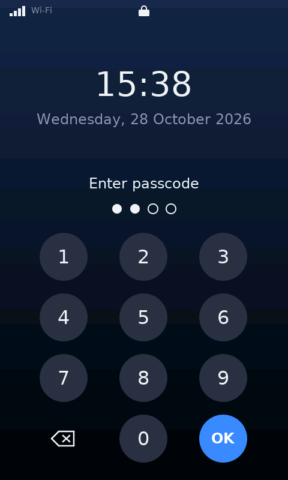
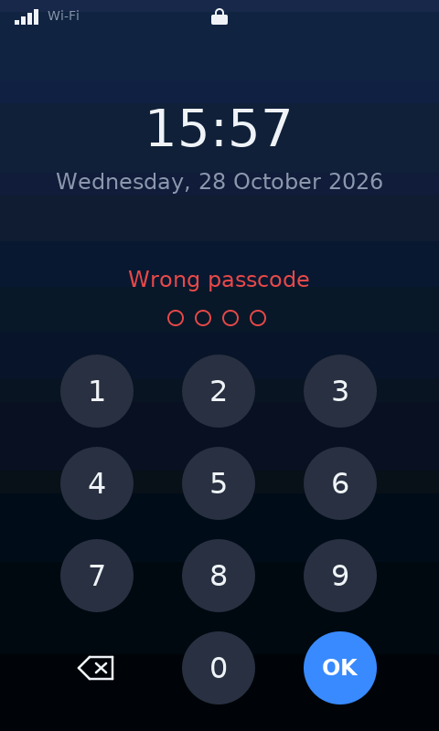
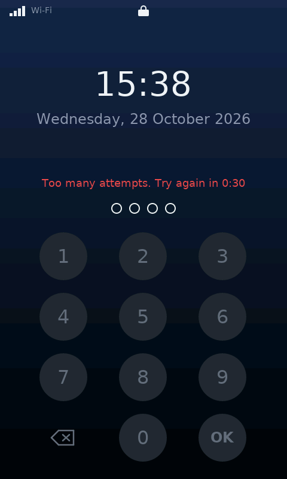
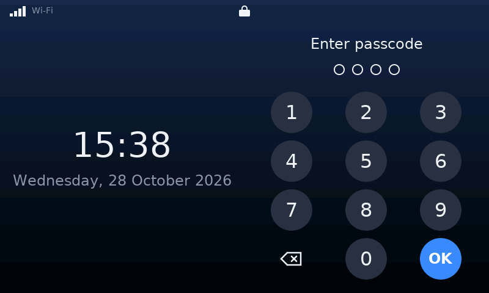
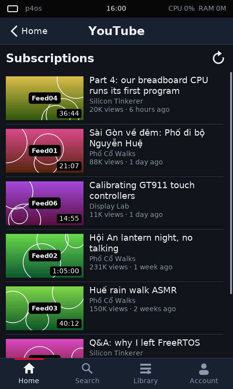
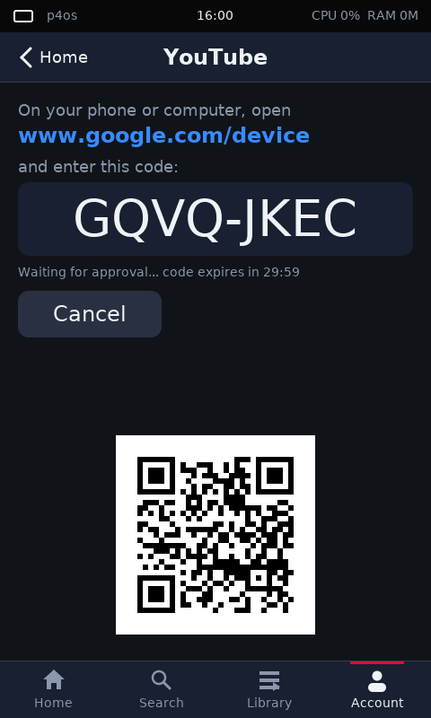

# p4os: build, flash và chạy

p4os là kernel viết bằng Rust, chạy bare-metal trên ESP32-P4 **rev v1.x**. Board mục tiêu là **Guition JC4880P443C**: màn 4,3" 480×800 ST7701S, cảm ứng GT911, codec ES8311, chip Wi-Fi ESP32-C6. Nó không dùng esp-hal, ESP-IDF hay FreeRTOS.

## Yêu cầu

- Rust stable kèm target `riscv32imafc-unknown-none-elf` (khai báo trong `rust-toolchain.toml`).
- `esptool` ≥ 5 và `pyserial`.
- Board cắm qua cổng USB-Serial-JTAG, mặc định là `/dev/ttyACM0` (đổi bằng biến `PORT`).

## Lệnh

| Việc | Lệnh |
|---|---|
| Build ELF và đóng image app | `scripts/build-image.sh` → `out/p4os.bin` |
| Build rồi flash vào phân vùng `factory` (0x10000) | `scripts/flash.sh` |
| Reset board và xem console | `python3 scripts/monitor.py [giây]` |
| Giữ quyền dùng board riêng khi nhiều tiến trình chạy song song | `scripts/board-lock.sh <lệnh>` |
| Reset, gửi lệnh shell rồi in phản hồi | `python3 scripts/shell-session.py ps mem demo` |
| Chạy test trên máy host (gồm test của allocator TLSF) | `cargo test -p p4os-apps -p p4os-gui -p p4os-net -p p4os-sdk -p p4os-tlsf --target aarch64-unknown-linux-gnu` |

Thư mục build của cargo là `out/` (cấu hình trong `.cargo/config.toml`).

## Cách khởi động

1. ROM nạp bootloader cấp 2 ESP-IDF v5.5 có sẵn ở 0x2000. Phần này tạm thời vẫn giữ.
2. Bootloader ánh xạ hai segment flash: rodata cùng app descriptor ở `0x40000020`, code ở `0x41000040`. Sau đó nó nhảy vào `_start` (`kernel/src/boot.rs`).
3. Kernel làm các bước sau:
   - tắt các watchdog;
   - nâng CPU từ 90 MHz lên 360 MHz;
   - bật CLIC và tick 1 kHz (tick dừng khi cả hai core rảnh, xem mục "Quản lý năng lượng");
   - đánh thức core 1 (hart 1), log in `smp: hart 1 online`;
   - khởi động scheduler. Cả hai core cùng lấy thread từ một hàng đợi; mỗi core có thread `idle0`/`idle1` riêng.

Bố cục bộ nhớ nằm trong `kernel/link.x`. Bootloader bắt buộc có đúng hai segment flash, và segment 0 phải bắt đầu bằng `esp_app_desc_t`.

## Kiểm tra màn hình bằng camera

Có một camera Imou nhìn thẳng vào màn hình, dùng được qua `scripts/cam.py`. Mật khẩu RTSP lấy từ `~/.config/p4os/imou` (quyền 600). Địa chỉ camera mặc định là `192.168.88.7`, đổi được bằng `P4OS_CAM`.

| Việc | Lệnh |
|---|---|
| Tìm khung màn hình (nháy xám/đen), lưu vào `scripts/cam-roi.json` | `python3 scripts/cam.py calibrate` |
| Tô một màu và xác nhận camera thấy đúng màu đó | `python3 scripts/cam.py check 400000` |
| Chụp vùng màn hình, đứng chiều, tự giảm đèn nền xuống 3% khi chụp | `python3 scripts/cam.py shot out.png` |
| Chạm giả lập rồi chụp | `python3 scripts/board-ui.py "tap 80 132" "shot calculator"` |
| Chỉnh ảnh camera qua ONVIF (độ sáng, tương phản) | `python3 scripts/cam_onvif.py get` / `set Brightness=35` |
| Kiểm tra loa: phát âm thử và nghe bằng micro của camera | `python3 scripts/cam_audio.py 1000` |
| Lưu mạng Wi-Fi trong `~/.config/p4os/wifi` vào board bằng `wifi save` rồi kết nối (mật khẩu được che trong mọi output) | `python3 scripts/wifi-connect.py` |

Camera tự cân sáng nên bị cháy sáng khi panel hiện màu sáng. Vì vậy hãy dùng màu tối (khoảng 0x40) khi kiểm tra.

Mở cổng serial mà **không đổi DTR/RTS**. Nếu chỉ đổi một trong hai đường, USB-Serial-JTAG sẽ reset chip.

## Shell debug

Các lệnh: `help`, `uptime`, `clock`, `irq`, `ps` (kèm tải từng core, core đang/vừa chạy thread và core được ghim), `mem` (kèm mức dùng heap cao nhất kể từ lần `mem` trước và số stack đang chờ trong pool), `demo`, `smpdemo` (so sánh thông lượng 1 thread với 2 thread chạy song song), `membench`, `bench` (micro-benchmark kernel và CPU, so sánh với FreeRTOS: xem `bench/README.md`), `lcd` (trạng thái luồng hình), `hwscan` (dò phần cứng), `vpg on|off` (vạch màu thử của DSI host), `fill RRGGBB|off` (tô toàn màn hình một màu), `bl 0..100` (độ sáng đèn nền), `tap X Y` (giả lập một lần chạm), `sd` (dò thẻ SD), `ls [/sd/...]` (liệt kê thư mục), `format sd ERASE-ALL` (xoá thẻ và format theo chuẩn p4os: MBR với một phân vùng FAT32 bắt đầu ở 1 MiB, nhãn `P4OS`, có sẵn các thư mục `Music`, `Pictures`, `Documents`, `Notes`, `Paint`, `Apps`, `p4os`), `audio` (trạng thái âm thanh), `tone [Hz]` (phát âm thử 3 giây), `c6` (dò chip Wi-Fi), `wifi connect SSID PASS` (kết nối, không lưu), `get http://...` (tải một URL), `flash` (trạng thái driver flash và MMU), `power` (chế độ năng lượng, xem mục Quản lý năng lượng), `apps`, `run SLOT [ARG]`, `pmp` (app user, xem bên dưới), `lock` (trạng thái màn hình khoá), `lock now` (khoá ngay), `lock bench` (đo thời gian một lần kiểm tra mã), `lock reset CLEAR-PASSCODE` (xoá mã, xem mục Màn hình khoá). Cài đặt lưu trong flash: `wifi save SSID PASS` (lưu rồi kết nối), `wifi forget` (xoá mạng đã lưu), `wifi` (trạng thái), `config list` (in các khoá; mật khẩu Wi-Fi, các khoá `lock.*` và khoá bí mật của YouTube chỉ hiện `[set]`), `config set KEY VALUE` (ghi một khoá; giá trị của khoá bí mật hiện thành `*` khi gõ và không bao giờ được in lại; các khoá `lock.*` bị từ chối, mã khoá chỉ đổi được trong Settings hoặc bằng `lock reset`), `config unset KEY` (xoá một khoá, trừ `lock.*`), `config stress N` (lưu N lần một khoá thử trong lúc hai thread giữ bận cả hai core, rồi xoá khoá đó và kiểm tra các khoá khác còn nguyên). Nhấn **Ctrl-T** bất cứ lúc nào để in bảng thread ngay từ ngữ cảnh ngắt, kể cả khi mọi thread đã treo.

## Cài đặt lưu trong flash

Bố cục flash 16 MiB (theo bảng phân vùng có sẵn):

| Vùng | Nội dung |
|---|---|
| `0x0..0x10000` | bootloader (`0x2000`), bảng phân vùng (`0x8000`) |
| `0x10000..` | phân vùng `factory`: kernel, chạy thẳng từ flash qua cache |
| `0x710000..0x720000` | 64 KiB đầu của phân vùng `storage`: cài đặt của kernel (`kernel/src/config.rs`) |
| `0x720000..0x800000` | 14 slot app user, mỗi slot 64 KiB (`scripts/flash-app.sh`); kernel chỉ đọc |
| `0x800000..0xD10000` | phần còn lại của `storage`, dành cho việc khác; kernel không đụng tới |

- Cài đặt nằm ở hai sector 4 KiB luân phiên (`0x710000`, `0x711000`). Mỗi bản ghi có số thứ tự và CRC-32; lúc khởi động kernel chọn bản ghi hợp lệ mới nhất, nên mất điện giữa lúc ghi chỉ làm mất lần lưu đó. Định dạng nằm ở `sdk/src/config.rs`.
- Các khoá: `wifi.ssid`, `wifi.password`, `ui.orientation` (`portrait`/`landscape`), `ui.brightness` (phần trăm), `lock.enabled`, `lock.pin`, `lock.auto`, `lock.fails`, `lock.until` (xem mục Màn hình khoá), và các khoá `youtube.*` của app YouTube (xem mục App YouTube), `power.mode` (`performance`/`balanced`/`battery`, mặc định `balanced`), `power.dim_s` và `power.off_s` (số giây không thao tác trước khi giảm sáng / tắt màn hình, `0` = không bao giờ, mặc định 30 và 120). Hướng màn hình được lưu ngay khi đổi; độ sáng được lưu sau khi thanh trượt đứng yên 1,5 giây.
- Nếu đã lưu mạng Wi-Fi, lúc khởi động thread `wifi-auto` tự kết nối ở nền, không chặn boot. Khi lỗi nó thử lại sau 5 s, 10 s, 20 s… tối đa 2 phút. App Settings, mục Wi-Fi, có ô SSID/mật khẩu và nút Connect (lưu rồi kết nối).
- Xoá/ghi flash chạy từ SRAM (section `.sram_text` trong `kernel/link.x`), với ngắt bị chặn và L2 cache tạm dừng, vì kernel đang chạy từ chính flash này. Thread gọi ghi phải có stack trong SRAM nội.

## Màn hình khoá

| Màn hình khoá | Nhập sai | Bị khoá tạm | Ngang |
|---|---|---|---|
|  |  |  |  |

- Bật trong Settings > Security: công tắc **Lock screen**, nút **Set passcode** (hoặc **Change** / **Remove** khi đã có mã), và **Auto-lock**: `Screen off` (mặc định), `1 min`, `5 min`, `Never`. Mã là 4–8 chữ số, nhập hai lần để xác nhận. Bật công tắc khi chưa có mã thì sẽ chuyển sang bước đặt mã; đổi mã, xoá mã hay tắt khoá đều phải nhập mã hiện tại.
- Màn hình khoá chỉ hoạt động khi đã bật **và** đã có mã. Nó hiện lúc khởi động, khi chạm biểu tượng ổ khoá trên thanh trạng thái (hoặc lệnh `lock now`), và tự khoá theo Auto-lock. Chế độ `Screen off` khoá khi màn hình tắt theo `power.off_s` (mục Quản lý năng lượng); trước lần tắt màn hình đầu tiên sau khi khởi động, nó vẫn dùng mốc dự phòng 1 phút không chạm. Nếu đặt `power.off_s` = 0 thì màn hình không tắt và sau lần đầu đó khoá không tự bật. `1 min` / `5 min` tính từ lần chạm cuối.
- Khi khoá, không phần nào của app hay thanh trạng thái được vẽ và không app nào nhận chạm; app vẫn chạy nền (ví dụ nhạc vẫn phát). Lần chạm đánh thức màn hình không được tính là phím.
- Mã không bao giờ được lưu dạng rõ: `lock.pin` chứa `v1$<số vòng>$<salt>$<hash>`, là PBKDF2-HMAC-SHA256 với salt ngẫu nhiên 16 byte lấy từ bộ sinh số ngẫu nhiên của chip, 10 000 vòng; so sánh hash theo thời gian hằng. Mã và hash không bao giờ được in ra serial. Trên board (360 MHz, SHA-256 bằng phần mềm) một lần kiểm tra mất khoảng 305 ms (`lock bench`); màn hình khoá hiện "Checking..." trong lúc đó.
- Giới hạn thử: sau 5 lần sai bị khoá 30 giây, mỗi 5 lần sai tiếp theo thời gian gấp đôi (60 s, 120 s, …), tối đa 15 phút. Số lần sai (`lock.fails`) và lần khoá đang chờ (`lock.until`) được lưu trong flash nên khởi động lại không xoá được: nếu đồng hồ đã đặt, thời điểm hết khoá được giữ nguyên; nếu chưa, lần khoá bắt đầu lại từ đầu sau khi khởi động. Nhập sai mã hiện tại trong Settings cũng bị tính và có thể khoá màn hình.
- **Quên mã**: trên console serial gõ `lock reset`, rồi `lock reset CLEAR-PASSCODE`. Lệnh xoá mã, tắt khoá và xoá bộ đếm. Lệnh này bị từ chối khi chạy từ app Terminal. Giới hạn cần nói rõ: console serial (cổng USB) được coi là giao diện tin cậy, nên ai cầm được board và cắm cáp đều mở được khoá. Ngoài ra flash không mã hoá, nên người có quyền truy cập vật lý có thể đọc hash và dò mã ngoại tuyến (mã 4–8 chữ số có ít khả năng). Màn hình khoá chống người lạ dùng màn hình cảm ứng, không chống người có cáp và thời gian.

## Quản lý năng lượng

Board chạy pin (IP5306), nên kernel có ba chế độ, chọn trong Settings > Power hoặc bằng `power mode performance|balanced|battery` (lưu ở khoá `power.mode`). Mã nằm ở `kernel/src/power.rs`.

| | performance | balanced (mặc định) | battery |
|---|---|---|---|
| Xung CPU | luôn 360 MHz | 180–360 MHz khi màn hình sáng, xuống 90 MHz khi tắt | 90–180 MHz khi màn hình sáng, xuống 40 MHz khi tắt |
| Tick 1 kHz | luôn chạy | dừng khi cả hai core rảnh (tickless) | tickless |
| Wi-Fi (ESP-Hosted `Req_WifiSetPs`) | không ngủ | modem sleep tối thiểu | modem sleep tối đa |
| Clock gate khi `wfi` (`HP_SYS 0x118`) | tắt | tắt | bật |
| Hỏi cảm ứng khi màn hình tắt | 50 ms | 100 ms | 200 ms |

- **Tickless** (`kernel/src/time.rs`): tick k luôn nằm trên lưới `EPOCH + k·1 ms` của systimer (chạy từ XTAL, không đổi theo xung CPU). Khi cả hai core đang chạy thread idle, `time::stop` hẹn alarm tới lúc thread ngủ sớm nhất cần dậy (tối đa 1 s). Trong lúc đó `ticks()` đọc thẳng vị trí trên lưới. Tick chạy lại khi alarm đó tới, hoặc khi một core đổi thread (`sched::switch` gọi `time::resume`), và số tick đã trôi qua được cộng một lần cho thread ngủ, thời gian chạy và tải CPU. Scheduler chỉ thêm hai điểm nối: `when_all_idle` và `on_tick(now, elapsed)`.
- **Đổi xung** (`kernel/src/clock.rs`): bốn mức theo `rtc_clk.c` của ESP-IDF: 360 (CPLL /1, MEM/SYS 180, APB 90), 180 (CPLL /2, MEM/SYS 180, APB 90), 90 (CPLL /4, mọi bus 90) và 40 MHz (XTAL, mọi bus 40). Systimer, I2C, I2S, LEDC (XTAL), SDMMC (PLL_F160M), xung pixel DSI (PLL_F240M) và PSRAM (MPLL) có nguồn riêng nên không phải lập trình lại. Thread `power` lấy mẫu thời gian `wfi` của từng core mỗi 100 ms (500 ms khi tắt màn hình): tải > 75 % thì lên mức nhanh nhất, < 40 % (tính theo mức chậm hơn) ba lần liền thì xuống một mức. Chạm màn hình và truyền mạng gọi `power::boost` để lên ngay mức nhanh nhất; âm thanh đang phát giữ ít nhất 180 MHz.
- **Màn hình**: thread GUI giảm đèn nền còn 25 % sau `power.dim_s`, rồi sau `power.off_s` thì dừng DMA khung hình, chuyển DSI sang command mode, gửi `0x28` (display off) và `0x10` (sleep in) cho ST7701S. Một lần chạm đánh thức màn hình (`0x11`, `0x29`, chạy lại DMA) và **không** được chuyển cho app. Chạm giả lập `tap X Y` vẫn được chuyển. `bl N` và `fill` cũng bật lại màn hình. Mỗi lần màn hình tắt hoặc bật lại từ trạng thái tắt, thread GUI gọi `Desktop::on_screen_off` / `on_wake` để màn hình khoá xử lý.
- Lệnh shell: `power` (trạng thái, kể cả điện áp pin), `power stat [S]` (đo trong S giây: % thời gian `wfi` và số lần thức dậy mỗi giây của từng core, số ngắt tick, tỉ lệ thời gian ở từng mức xung), `power freq auto|360|180|90|40` (ghim xung để thử), `power screen on|dim|off`, `power dim S`, `power off S`, `power gate auto|on|off`.
- **Điện áp pin**: BAT+ qua cầu chia R52 68k / R57 100k vào GPIO53 (ADC2 kênh 4, suy giảm 12 dB), đổi sang mV bằng hiệu chuẩn eFuse như `adc_cali_curve_fitting` của ESP-IDF (`kernel/src/battery.rs`). Hiện ở thanh trạng thái và Settings > Power. Khi cắm USB, đây là điện áp sạc của IP5306 chứ không phải điện áp nghỉ của pin.

Số đo trên board (không có đồng hồ đo dòng, nên dùng số liệu thay thế; Wi-Fi đã kết nối, màn hình chính):

| Trạng thái | Xung | Core 0 thức dậy | Core 1 thức dậy | Ngắt tick |
|---|---|---|---|---|
| performance, màn hình sáng | 360 MHz | ~720/s | ~80/s | 1000/s |
| balanced, màn hình sáng | 180/360 MHz | ~170/s | ~78/s | ~440/s |
| balanced, màn hình tắt | 90 MHz | 32/s (99,3 % `wfi`) | 0 | 32/s |
| battery, màn hình tắt | 40 MHz | 17/s (99,5 % `wfi`) | 0 | 17/s |

Những điều đã kiểm chứng và giới hạn:

- `wfi` vẫn đánh thức core khi ngắt đang bị che (`mstatus.MIE = 0`), nên quyết định dừng tick và `wfi` nằm trong cùng một đoạn che ngắt.
- `mcycle` vẫn đếm đủ tốc độ trong `wfi`, kể cả khi đã xoá `CPU_WAIT_MODE_FORCE_ON`. Vì vậy không đo được clock gate có thật sự tắt xung lõi hay không; kernel dùng chính `mcycle` để tính thời gian `wfi`. ESP-IDF ghi chú rằng khi bật gate này, debugger JTAG không truy cập được bộ nhớ lúc core đang `wfi`, nên chỉ chế độ battery bật nó. Không có cách ngủ sâu hơn cho core 1 mà vẫn nhận IPI: tắt `CORE1_CPU_CLK_EN` hay stall qua PMU sẽ cần scheduler biết đưa core 1 offline.
- Ở 90 MHz màn hình chạy 53 khung/s không underrun. Ở 40 MHz (bus 40 MHz) có underrun, nên khi màn hình sáng không bao giờ xuống 40 MHz. ESP-IDF giữ xung tối đa khi DSI chạy; ở đây balanced giữ ≥ 180 MHz (bus không đổi so với 360 MHz).
- HTTPS (`get https://example.com`) và thẻ SD chạy ở mọi chế độ, kể cả 40 MHz với modem sleep tối đa (bắt tay TLS 846 ms so với 478 ms ở balanced).
- DMA âm thanh không tạo ngắt EOF nào trên `main` lẫn bản này (`audio`: `eof 0`), nên chưa kiểm chứng được âm thanh theo từng chế độ. Khi nó chạy, thread âm thanh sẽ che ngắt EOF và tắt ampli sau 4 buffer im lặng.
- `bench` ở chế độ performance so với `main` cùng ngày: thông lượng (memcpy, CRC32, integer) như nhau; chuyển ngữ cảnh, yield, mutex và độ trễ ngắt khi idle chậm hơn 1–2,5 %; độ trễ vào ngắt khi CPU bận chậm hơn khoảng 25 ns (4–6 %). Vòng idle ở chế độ này giữ nguyên `wfi` cũ. Trước khi tách riêng như vậy, đoạn đo thời gian sau `wfi` làm độ trễ ngắt khi idle tăng gấp đôi.
- `uptime` qua 32 s tickless (màn hình tắt) lệch so với đồng hồ máy chủ trong phạm vi độ trễ serial (32 042 ms).
- Còn tốn điện: I2C hỏi cảm ứng 100 kHz bằng vòng chờ bận mỗi 16 ms khi màn hình sáng; thread `net` hỏi ESP32-C6 qua SDIO mỗi 10–100 ms vì chưa dùng ngắt SDIO. IP5306 tự tắt nguồn khi tải dưới khoảng 45 mA trong 32 s; nếu board tắt khi màn hình tắt thì đó là nguyên nhân.

## App user (U-mode, cách ly bằng PMP)

App user là binary riêng, không link vào kernel. Kernel nạp app từ flash vào một vùng RAM riêng rồi chạy nó ở U-mode. App chỉ đọc/ghi được vùng nhớ của chính nó và gọi kernel qua `ecall` (syscall).

| Việc | Lệnh |
|---|---|
| Build `userapps/` và đóng gói thành image | `scripts/build-userapps.sh` → `out/userapps/hello.p4app`, `crash.p4app` |
| Ghi image vào slot N (0..13, địa chỉ 0x720000 + N×0x10000). Script tự giữ khoá board | `scripts/flash-app.sh 0 out/userapps/hello.p4app` |
| Liệt kê các slot hợp lệ (tên, kích thước) | shell: `apps` |
| Chạy app ở slot N với tham số tuỳ chọn. Shell chờ đến khi app kết thúc | shell: `run 0`, `run 1 3` |

- Nếu app truy cập ngoài vùng của nó, kernel chỉ dừng app đó và in một dòng `*** app 'crash' (thread 7) killed: store access fault ...`. Kernel, màn hình và shell vẫn chạy bình thường. `run 1 N` (N = 0..6, 8, 9) thử từng kiểu vi phạm, xem bảng trong `userapps/crash/src/main.rs`.
- App luôn chạy trên core 1. Bootloader ESP-IDF khoá PMP entry 0–2 của core 0 (CLIC, cache controller, ROM vẫn chạm được từ U-mode), còn core 1 không bị khoá entry nào. Lệnh `pmp` in trạng thái PMP của từng core.
- Giới hạn phần cứng: trên core 1, truy cập U-mode vào vùng CPU subsystem (0x20000000.., gồm CLIC) bị chặn nhưng **không sinh exception**, core 1 treo đến khi reset. **Đừng chạy `run 1 7`** khi người khác đang dùng board.
- ABI syscall, định dạng image và cơ chế PMP: [plans/261028-1217-user-mode-apps/design.md](../plans/261028-1217-user-mode-apps/design.md).
- Khi build trong git worktree, cargo gộp cả `.cargo/config.toml` của repo cha nên `-Tlink.x` bị lặp. Khi đó hãy build kernel với `RUSTFLAGS="-C link-arg=-Tlink.x"`.

## Khôi phục firmware gốc

```
esptool --chip esp32p4 --port /dev/ttyACM0 write-flash 0 ~/backups/esp32p4/flash-factory-30eda0e19d99.bin
```

## Những điều riêng của P4 v1.x đã kiểm chứng

- CLIC ở đây khác chuẩn. Ngưỡng ngắt nằm ở thanh ghi `0x20800008` (bit 31:24), không phải CSR. Ngoại vi dùng các đường CLIC 16..47.
- Khi `mret` sang một thread khác, `mcause` phải giữ bit ngắt và mã nguyên nhân của trap đang xử lý. Nếu không, đường ngắt đó kẹt ở trạng thái "đang phục vụ" và không bao giờ kích hoạt lại (xem `kernel/src/trap.rs`).
- Thứ tự đổi bộ chia khi tăng xung là APB → SYS → MEM → CPU, sau đó mới chọn nguồn CPLL. Lý do: MEM_CLK phải ≤ 200 MHz và APB_CLK ≤ 100 MHz.

## Đa lõi (SMP): những điều đã kiểm chứng

- Cách đánh thức core 1 theo `start_other_core` của ESP-IDF v5.5: gỡ stall trong `PMU_CPU_SW_STALL` (mã 0xFF), bật `CORE1_CPU_CLK_EN` và gỡ `RST_EN_CORE1_GLOBAL` trong HP_SYS_CLKRST, rồi gọi hàm ROM `ets_set_appcpu_boot_addr` (0x4FC000A8) với địa chỉ `_start_hart1` (`kernel/src/smp.rs`).
- Lúc nhảy vào kernel, ROM chạy core 1 trên stack riêng ngay dưới 0x4FF3EFC0. Vùng này nằm trên `_heap_end`, nên heap không bị ghi đè.
- CLIC của từng core nằm ở cùng địa chỉ 0x20800000, và mỗi core có ma trận ngắt riêng. `irq::attach` gắn ngắt vào core đang gọi. Tick 1 kHz chạy trên core 0 và tính giờ cho cả hai core.
- Ngắt liên core (IPI) dùng nguồn FROM_CPU 79 + hart, gắn vào đường CLIC 47 (driver lấy đường từ 16 trở lên, `bench` dùng đường 20). Ghi 1 vào `HP_SYS + 0x10 + 4·hart` để báo, bên nhận ghi 0 để xoá.
- Scheduler, heap, thao tác cache, MMU flash, bộ sinh số ngẫu nhiên và các lệnh đọc-sửa-ghi thanh ghi (`mmio::set_bits`/`clear_bits`/`modify`) dùng spinlock (`kernel/src/spin.rs`): nâng ngưỡng CLIC để chặn ngắt mức kernel trên core hiện tại (xem mục dưới), rồi chờ một atomic LR/SC. `Semaphore`/`Mutex` chỉ vào scheduler khi phải chờ hoặc khi có thread đang chờ; lấy và trả khi không tranh chấp chỉ là atomic. `irq::free` chặn mọi ngắt nhưng chỉ trên core hiện tại. Spinlock phải là biến static trong SRAM.
- Console không giữ ngắt tắt trong lúc chờ USB rút FIFO (có thể mất ~1 ms): các thread xếp hàng bằng một `Mutex`; trình xử lý ngắt và code đang giữ spinlock in thẳng ra.
- Ghi/xoá flash tạm dừng cache, mà core kia vẫn chạy code từ flash qua cache đó. Vì vậy `smp::with_other_core_parked` gửi IPI để core kia vào một vòng lặp nằm trong SRAM (`.sram_text`, ngắt tắt, stack ngắt ở SRAM), chờ nó báo đã vào rồi mới tạm dừng cache. Trong lúc xoá một sector (~45 ms) ngắt bị tắt, nên `irq` sau khi lưu cài đặt báo độ trễ tick cỡ 48 ms; ngoài lúc đó độ trễ dưới 50 µs.
- `mcycle` là bộ đếm riêng của từng core (core 1 bắt đầu đếm muộn hơn khoảng 1 giây), nên `bench` ghim mọi thread của nó vào core 0.
- `sched::spawn_on(Some(core), ...)` ghim thread vào một core; mặc định thread chạy trên core nào cũng được.

## Ngắt: mức kernel, mức nhanh và task notification

- Mức 1..3 (`irq::KERNEL_LEVEL`) là **mức kernel**: handler được dùng spinlock, `Semaphore::release`, `sched::notify`. Critical section của kernel (mọi `SpinLock`) chỉ nâng ngưỡng CLIC (`0x20800008`) lên mức 3 thay vì tắt `mstatus.MIE`, nên ngắt mức 4..7 vẫn chạy khi thread đang giữ lock.
- Mức 4..7 là **mức nhanh**: màn hình (page flip, mức 6) và audio (DMA xong, mức 5). Handler mức nhanh **không được lấy lock nào** (spinlock, semaphore, mutex, cấp phát, `mmio::set_bits`/`modify`): chỉ đọc/ghi thanh ghi, atomic và gọi `sched::notify`. Nếu code bị ngắt đang trong critical section, `notify` để việc đánh thức lại cho IPI tự gửi tới chính core đó (mức 1), chạy ngay khi critical section kết thúc.
- Trap không lồng nhau: ngắt nhanh vẫn phải chờ handler đang chạy. Nó chỉ không còn phải chờ critical section phía thread.
- `sched::notify(id, bits)` / `sched::wait_notify(mask)`: mỗi thread có 32 bit notification, đánh thức đúng một thread với tối đa một lần lấy scheduler lock. Bit dùng chung khai báo ở `sched::notify_bits`. Màn hình, audio và console RX dùng cơ chế này thay cho semaphore.
- Chi phí đo bằng `bench`: vào+ra critical section bằng ngưỡng CLIC mất ~151 ns, so với ~53 ns khi bật/tắt `MIE` (ghi thanh ghi rồi đọc lại để ngưỡng có hiệu lực). `Semaphore`/`Mutex` không tranh chấp chỉ dùng atomic (mutex lock+unlock ~365 ns, trước đây ~620 ns).
- `irq::attach` báo lỗi nếu đường CLIC đã có handler khác (lỗi cũ: IPI và alarm của `bench` dùng chung đường 20 làm `bench` treo).
- `smpdemo` đo được 1 thread 1116 ms, 2 thread 1116 ms, tức thông lượng gấp khoảng 2 lần. `config stress 50` chạy song song với tải trên cả hai core: 100 lần lưu đều đúng và không treo.

## Heap

- Mỗi vùng nhớ (SRAM, PSRAM) có một allocator TLSF riêng (crate `tlsf/`, gọi từ `kernel/src/heap.rs`), mỗi vùng một spinlock. Alloc và free chạy trong thời gian hằng, nên thời gian giữ lock (có che ngắt) ngắn và có cận trên, dù heap phân mảnh đến đâu. Khối nhỏ hơn 64 KiB vào SRAM trước, khối lớn vào PSRAM trước, vùng kia dùng làm dự phòng khi hết chỗ.
- Mỗi khối có header 8 byte và được làm tròn lên bội số 16 byte. Vì thế vùng SRAM 256 KiB không còn chứa vừa đúng hai khối 128 KiB (`bench` copy SRAM dùng 2 × 127 KiB).
- **Không được dùng heap trong trình xử lý ngắt.** Mọi lối vào heap đều kiểm tra stack pointer; nếu đang ở stack ngắt thì panic với thông báo `heap used from interrupt context`. Trong ngữ cảnh ngắt, console in thẳng ra USB thay vì ghi vào bộ đệm capture, nên Ctrl-T và thông báo lỗi không cấp phát.
- Stack của thread cỡ 2/4/8/16/24/32/48 KiB lấy từ pool riêng của từng cỡ. Khi thread thoát, stack của nó được giữ lại trong pool cho thread sau cùng cỡ, thay vì trả về heap, nên spawn/thoát thread liên tục không làm SRAM bị thủng lỗ chỗ. `mem` in số stack đang nằm chờ trong pool. Phần bộ nhớ này vẫn được tính là đã dùng.
- Đo bằng `bench` (thời gian một lần alloc, ngắt bị che trong lúc đo, heap có N lỗ trống xen giữa các khối còn sống). Với N = 16/256/1024, thời gian tối đa là 1,08/1,12/1,15 µs. Allocator first-fit cũ cần 0,82/4,2/12,8 µs cho alloc và tới 23,7 µs cho free. Trên heap sạch, một cặp alloc+free 32 B mất 1,26 µs (first-fit cũ: 0,60 µs). Đây là cái giá để đổi lấy cận trên.

## Màn hình: những điều đã kiểm chứng

- Panel là ST7701S 480×800, dùng 2 lane ở 500 Mbps, xung pixel 30 MHz (PLL_F240M/8). Timing H 12/42/42, V 2/8/166. Bảng lệnh khởi tạo nằm trong `kernel/src/display.rs`.
- **Reset LCD ở GPIO5** (mức thấp là reset). Thiếu bước reset này thì panel vẫn ACK lệnh nhưng màn hình chỉ đen. Đèn nền nối vào chân EN của mạch boost MP3202 qua GPIO23, mức cao là bật.
- Thông tin chung về board EV của Espressif (EK79007, 1024×600, đèn nền GPIO26) **không đúng** với board này. Nguồn đáng tin là gói tài liệu JC4880P443 của nhà sản xuất cùng các thanh ghi đọc qua JTAG từ firmware gốc (xem `scripts/regdump.sh`).

## Ngoại vi khác

| Thiết bị | Trạng thái | Ghi chú |
|---|---|---|
| Thẻ SD (SDMMC slot 0, 4-bit, 20 MHz) | Đọc và ghi block chạy được. Filesystem FAT32 có tên file dài, mount ở `/sd` | Phải bật LDO4 3,3 V trước. CPU đọc trực tiếp FIFO (offset 0x200) **không lấy được dữ liệu ra khỏi FIFO** trên chip này, nên driver dùng IDMAC với bộ đệm trung gian ở SRAM không qua cache. |
| Âm thanh (I2S1 → ES8311 → loa, PA ở GPIO11) | DMA, I2S và codec chạy, đã kiểm chứng bằng thanh ghi | Chưa gắn loa nên chưa nghe thử được. |
| Đèn nền | PWM 20 kHz qua LEDC trên GPIO23 | Thanh độ sáng trong Settings điều khiển trực tiếp. |
| Cảm ứng GT911 (I2C 0x5D) | Driver và cách ánh xạ toạ độ đã có | Chưa kiểm chứng bằng chạm thật. |
| Wi-Fi (ESP32-C6 qua ESP-Hosted v2, SDIO) | Chạy: kết nối WPA2, DHCP, DNS, SNTP, TCP, HTTP/1.0 (smoltcp) và HTTPS. App Browser tải được trang `http://` và `https://` trên board | Lúc nhận dạng thẻ phải giữ D3 (GPIO17) ở mức cao như GPIO thường. Host báo sẵn sàng bằng cách ghi `0x01` vào SCRATCH_7 (0x08C). Mỗi lần CMD53 phải đọc **đúng** số byte đang chờ, đọc dư sẽ làm C6 ngừng trả lời. Firmware slave v2.3.x cần gửi đủ `threshold` và `pmf_cfg` trong cấu hình STA, nếu thiếu C6 sẽ treo. Chưa có BLE. |

Một bẫy với systimer: comparator chỉ kích hoạt khi bộ đếm **bằng** giá trị đích. Nếu deadline đã trôi qua lúc ngắt đang tắt, tick sẽ dừng vĩnh viễn. `time::arm` xử lý trường hợp này bằng cách hẹn sang tick kế tiếp trên lưới; số tick bị lỡ được tính lại từ lưới khi ngắt chạy.

## HTTPS

- Dùng rustls 0.23 (`no_std`, API unbuffered) với bộ mã hoá thuần Rust `rustls-rustcrypto`. Hỗ trợ TLS 1.3 và TLS 1.2 (ECDHE, AES-GCM, ChaCha20). Phần logic HTTP, SNTP và TLS nằm trong crate `net/` (`p4os-net`), dùng chung cho kernel và simulator.
- Chứng chỉ được **kiểm tra thật** với kho CA gốc của Mozilla (`webpki-roots`). Chứng chỉ hết hạn, sai tên miền hoặc tự ký đều bị từ chối, Browser báo "Secure connection failed".
- Kiểm tra hạn chứng chỉ cần giờ đúng. Sau DHCP, kernel hỏi SNTP (`pool.ntp.org`, rồi `time.cloudflare.com`, `time.google.com`) và đặt đồng hồ theo **UTC**. Yêu cầu HTTPS trong 15 giây đầu sẽ chờ có giờ. Nếu SNTP không trả lời, HTTPS báo lỗi "clock not set" (có thể đặt giờ trong Settings).
- Số ngẫu nhiên lấy từ thanh ghi RNG `0x5011_01A4`, trộn với bộ đếm chu kỳ qua SHA-256 (`kernel/src/rng.rs`). Lúc chạy, nguồn nhiễu SAR ADC không bật, nên entropy chỉ đến từ dao động RC.
- Đo trên board (360 MHz): handshake TLS 1.3 mất 0,25–0,9 giây, TLS 1.2 với RSA-4096 hoặc ECDSA P-384 mất 1,1–1,6 giây. Một lần tải HTTPS dùng thêm khoảng 45 KB SRAM lúc cao nhất. Stack của thread `net` dùng khoảng 16 KB trên 48 KB. Image firmware tăng từ 1,2 MB lên 2,4 MB (phân vùng `factory` có 7 MB).
- Giới hạn: không có session resumption và keep-alive, nên mỗi lần tải là một handshake mới. Phản hồi được đọc trọn vào RAM. Simulator cũng hỗ trợ HTTPS qua cùng crate.

## App YouTube

App YouTube dùng YouTube Data API v3 chính thức: Home (feed từ các kênh đã đăng ký khi đăng nhập, video thịnh hành khi chưa đăng nhập), Search, Library (video đã thích, playlist, kênh đã đăng ký) và Account. Chưa phát được video trên board: nút Play hiện mã QR với link `https://youtu.be/<id>` để xem trên điện thoại.

 

Không có khoá nào được ghi sẵn trong mã nguồn. Mỗi người tự tạo dự án Google Cloud của mình:

1. Vào <https://console.cloud.google.com/>, tạo một project mới (ví dụ `p4os`).
2. **APIs & Services → Library**, tìm **YouTube Data API v3** và bấm **Enable**.
3. **APIs & Services → OAuth consent screen** (Google Auth Platform): chọn loại **External**, điền tên app và email. Ở mục **Audience → Test users**, thêm tài khoản Google bạn sẽ đăng nhập. Không cần thêm scope ở đây; app chỉ xin `youtube.readonly`.
4. **Clients → Create client**, chọn loại **TVs and Limited Input devices**. Ghi lại **Client ID** và **Client secret**.
5. (Tuỳ chọn, để xem thịnh hành và tìm kiếm khi chưa đăng nhập) **Credentials → Create credentials → API key**, nên giới hạn key chỉ dùng cho YouTube Data API v3.
6. Trên console nối tiếp của board:

```
config set youtube.client_id 1234567890-abc.apps.googleusercontent.com
config set youtube.client_secret GOCSPX-...
config set youtube.api_key AIza...          # tuỳ chọn
config set youtube.region VN                # tuỳ chọn, vùng của mục thịnh hành
```

7. Mở app YouTube, tab **Account → Sign in with Google**. Màn hình hiện một mã ngắn (chữ to) và mã QR của `google.com/device`; mở trang đó trên điện thoại, nhập mã và đồng ý. App tự hỏi Google theo chu kỳ (`interval`, chậm lại khi Google trả `slow_down`) cho tới khi đăng nhập xong.

Ghi chú:

- Sau khi đăng nhập, app lưu refresh token vào khoá `youtube.refresh_token` trong flash. Khoá này, `youtube.client_secret` và `youtube.api_key` được coi là bí mật: `config list` và `config set` chỉ hiện `[set]`, và không có token nào được in ra cổng serial. **Sign out** thu hồi quyền ở phía Google và xoá token khỏi flash.
- App ở trạng thái **Testing** trên màn hình consent: refresh token hết hạn sau 7 ngày. Khi đó app báo cần đăng nhập lại và tự xoá token cũ. Muốn token dài hạn thì phải publish app.
- Quota mặc định 10.000 đơn vị mỗi ngày, đặt lại lúc nửa đêm giờ Thái Bình Dương. Một lần tìm kiếm tốn 100 đơn vị; các lệnh khác (thịnh hành, chi tiết video, đã thích, playlist, đăng ký) tốn 1. Feed đăng ký được ghép từ 20 kênh (đăng ký, kênh, 1 playlist upload mỗi kênh, chi tiết video), khoảng 23 đơn vị mỗi lần làm mới, và được giữ 15 phút. Số đơn vị đã dùng trong ngày lưu ở `youtube.quota` và hiện ở tab Account; app từ chối lệnh vượt quota và dừng tới hôm sau khi Google báo `quotaExceeded`.
- Ảnh thu nhỏ (`i.ytimg.com/vi/<id>/mqdefault.jpg`) chỉ được tải cho các dòng đang hiện trên màn hình, tối đa 2 lượt tải cùng lúc, giải mã mỗi khung hình một ảnh và không giải mã khi đang chạm màn hình; cache giữ tối đa 40 ảnh 160x90 (khoảng 1,1 MB, nằm trong PSRAM).
- Ảnh chụp từ simulator (dữ liệu mẫu tự tạo, không dùng tài khoản thật): `cargo sim --script sim/fixtures/youtube/screens.sim`, ghi ra `docs/screenshots/youtube-*.png`.
