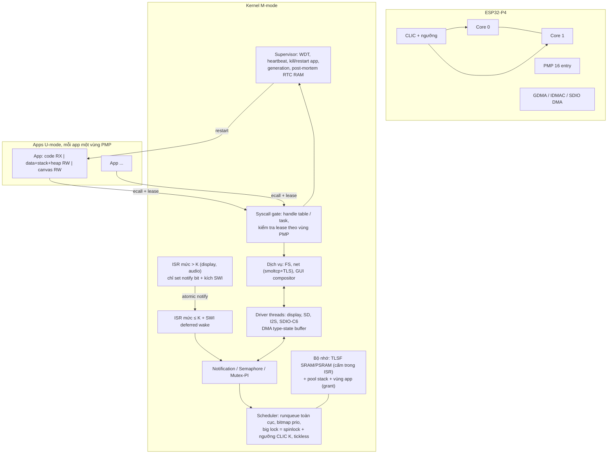

# Kiến trúc OS nhúng hiện đại (2022–2026) và những gì p4os nên áp dụng

Ngày: 2026-10-28. Phạm vi: quản lý tài nguyên và cấu trúc kernel cho p4os trên ESP32-P4 (2× RV32 @360 MHz, 768 KiB SRAM, 32 MiB PSRAM, PMP, CLIC).

## Kết luận

p4os **không cần đổi sang microkernel**. Kiến trúc hiện tại (kernel M-mode nguyên khối, một runqueue toàn cục, một big lock cho cả 2 core) trùng với lựa chọn của Ariel OS (2025), OS Rust đa core gần với p4os nhất, và các primitive của nó đã nhanh hơn FreeRTOS trên cùng board. Ba điểm yếu thật nằm ở **độ trễ tối đa**, **khả năng chịu lỗi** và **cách ly app**, không nằm ở throughput:

1. Critical section dài vì che toàn bộ ngắt (`irq::free`, mọi `SpinLock`), cộng với allocator O(n) chạy khi đang che ngắt. Đây là nguồn của độ trễ ngắt max ~3 µs và ISR→thread max 9 µs.
2. Đường ISR→thread đi qua semaphore. Mỗi lần đánh thức phải lấy scheduler lock 3 lần và đánh thức *mọi* waiter.
3. Lỗi ở bất kỳ đâu làm sập cả hệ: `panic_handler` gọi `halt()`, watchdog thì tắt hết. Code hiện tại cũng chưa có U-mode: `trap.rs` chỉ xử lý `ecall` từ M-mode.

Thứ tự đề xuất, chi tiết ở mục 4:

1. Critical section theo ngưỡng CLIC kiểu SRP/BASEPRI, cộng với ISR chỉ "post notification".
2. Task notification 32 bit cho từng thread.
3. Allocator TLSF với lock không che ngắt.
4. Watchdog cùng supervisor.
5. Phase 7 làm theo mô hình Hubris/Tock: app U-mode, PMP, lease, vùng nhớ riêng cho mỗi app kiểu grant.
6. Mutex có priority inheritance.
7. Tickless idle.
8. Ownership DMA theo type-state.

**Không nên áp dụng:** EDF, runqueue riêng cho từng core, async-only (Embassy/RTIC làm kernel), capability system đầy đủ kiểu seL4/Zircon, cell swapping kiểu Theseus, và Hubris thuần tĩnh (vì mâu thuẫn với Phase 8, nạp app từ SD).

## 1. Khảo sát các kiến trúc

| Hệ | Ý tưởng cốt lõi | Cái p4os học được | Nguồn và độ tin cậy |
|---|---|---|---|
| **Hubris** (Oxide) | Task tĩnh khai báo trong `app.toml`. Kernel không cấp phát động. IPC đồng bộ send/recv/reply. **Lease** cho phép bên nhận truy cập bộ nhớ của bên gửi trong lúc bên gửi đang block. Ngắt được đổi thành *notification bit* gửi tới task, kernel che line ngắt cho tới khi task xử lý xong. Task supervisor (jefe) restart task bị lỗi, và generation number giúp các task khác phát hiện việc restart. Trong cùng priority không có time slicing. | Lease, ISR→notification, supervisor restart, generation | Docs chính thức ([reference](https://hubris.oxide.computer/reference/), [FAQ](https://github.com/oxidecomputer/hubris/blob/master/FAQ.mkdn)). Đang chạy trong sản phẩm (rack Oxide). Cao. |
| **Tock 2.x** | Capsule là driver trong kernel, an toàn nhờ Rust (không `unsafe`), chạy cooperative trên một stack. Process được cách ly bằng MPU/PMP và lập lịch preemptive. **Grant** là phần kernel heap nằm *trong vùng nhớ của process*, nên khi process chết thì thu hồi được trọn vẹn. Syscall bất đồng bộ (subscribe/allow/command/yield, upcall). Tài liệu thừa nhận: "if a capsule panics… the system can only recover by restarting". | Grant (thu hồi bộ nhớ khi app chết), kiểm tra quyền `allow` buffer | [Tock book](https://book.tockos.org/doc/design), [grant docs](https://docs.tockos.org/kernel/grant/), [SOSP'17](https://www.eecs.berkeley.edu/~prabal/pubs/papers/levy17tock.pdf). Cao. |
| **seL4** | Capability, IPC đồng bộ được tối ưu tới mức chu kỳ, có kiểm chứng hình thức. | Chỉ dùng làm mốc chi phí IPC trên RISC-V | [sel4.systems/performance](https://sel4.systems/performance.html). Cao. |
| **Zephyr 4.x** | Userspace: kernel object được kiểm tra quyền, memory domain (MPU/PMP). Ba kiểu ready queue (simple/scalable/multiq). Deadline chỉ dùng để phân xử giữa các thread *cùng* priority. SMP dùng directed IPI. Trên phần cứng không coherent có `CONFIG_KERNEL_COHERENCE`. | IPI có đích, chọn kiểu runqueue theo số thread, kiểm tra quyền kernel object | [scheduling](https://docs.zephyrproject.org/latest/kernel/services/scheduling/index.html), [SMP](https://docs.zephyrproject.org/latest/kernel/services/smp/smp.html). Cao. |
| **Ariel OS** (2025) | Xây trên Embassy cộng với scheduler preemptive đa core: runqueue toàn cục, big lock, tickless, priority inheritance. Chạy được trên ESP32-S3/C3. | Xác nhận rằng thiết kế SMP hiện tại của p4os là hợp lý | [arXiv 2504.19662](https://arxiv.org/html/2504.19662v1). Trung bình–cao (paper kèm code). |
| **pw_kernel** (Google Pigweed) | Kernel Rust cho Cortex-M và RISC-V. Không cấp phát động. IPC theo channel, mỗi channel chỉ có một message đang bay. Có "wait group" kiểu epoll. Có hai chế độ: protected (PMP) và lightweight. | Kênh IPC cấu hình lúc build, chế độ có/không bảo vệ | [design.rst](https://pigweed.googlesource.com/pigweed/sandbox/+/refs/heads/coverage/pw_kernel/design.rst). Trung bình (đang thử nghiệm). |
| **Embassy / RTIC** | Async executor, waker được gọi từ ISR. RTIC dùng SRP: lập lịch lúc compile, tài nguyên dùng chung bằng cách nâng ngưỡng priority của ngắt, mọi task dùng chung một stack. | Critical section theo ngưỡng thay vì che hết ngắt | [Tweede Golf](https://tweedegolf.nl/en/blog/65/async-rust-vs-rtos-showdown/), [RTIC book](https://git.pfzetto.de/mirror/rtic/raw/branch/gh-pages/2/book/en/index.html). Cao, nhưng số liệu đo từ năm 2022. |
| **Theseus** (OSDI'20) | Cell (crate) được swap lúc chạy, giảm "state spill". | Nguyên tắc: driver không giữ state hộ client | [OSDI'20](https://usenix.org/conference/osdi20/presentation/boos). Nghiên cứu, cần dynamic linking. |
| **Zircon/Fuchsia, Redox** | Handle/capability, mọi thứ đều chạy ở userspace, cần MMU. | Chỉ lấy ý tưởng "handle là số nguyên index vào bảng của từng task" cho ABI syscall | Kiến thức nền. Không áp dụng trực tiếp được vì P4 không có MMU. |

Ràng buộc phần cứng P4 đã kiểm chứng trong `~/ref/esp-idf/components/soc/esp32p4/include/soc/soc_caps.h` và `esp_hw_support/port/esp32p4/cpu_region_protect.c`:

- Có **16 entry PMP** (IDF dùng entry 0–15), granularity **128 B**.
- Có PMA và APM (giới hạn quyền truy cập của bus master, kể cả DMA).
- CLIC hỗ trợ nested ngắt bằng phần cứng.
- Không có cache coherent cho DMA. Theo [IDF mm_sync](https://docs.espressif.com/projects/esp-idf/en/latest/esp32p4/api-reference/system/mm_sync.html), phải tự gọi `esp_cache_msync`.

## 2. Quản lý tài nguyên: hiện trạng p4os và hướng hiện đại

| Mảng | p4os hiện tại (trích code) | State of the art | Khoảng cách |
|---|---|---|---|
| Bộ nhớ | First-fit, danh sách theo địa chỉ, O(n). Chạy dưới `SpinLock`, tức che ngắt (`heap.rs`). | TLSF O(1) (rlsf: 260–320 chu kỳ/alloc trên STM32F401). Pool/slab cho object cỡ cố định. Hubris/pw_kernel: kernel không cấp phát. Tock: grant theo từng process. | Không giới hạn được thời gian che ngắt khi heap bị phân mảnh. Thread stack và state của driver cùng nằm chung một heap. |
| Lập lịch | Bảng 16 thread, quét O(16) ở `pick_next`, `has_contender`, `on_tick`. Một runqueue chung cho 2 core. Tick 1 kHz chạy cả khi idle. | Bitmap priority + ctz (multiq của Zephyr). Tickless (Ariel, Zephyr). Directed IPI. | Thời gian giữ lock dài hơn cần thiết. Thức dậy mỗi ms dù không có việc. |
| Ngắt | Handler chạy ở M-mode, gọi thẳng `Semaphore::release` → `sched::wake` (lấy big lock). | Hubris: ISR chỉ set bit notification rồi che line. RTIC: tài nguyên được bảo vệ bằng ngưỡng priority. | Mọi ISR có đánh thức đều phải đi qua big lock, nên mọi critical section phải che *tất cả* ngắt. |
| Đồng bộ | `Semaphore` đánh thức mọi waiter (thundering herd). `Mutex` không có priority inheritance. | Notification 1-waiter, priority inheritance (Ariel, FreeRTOS), priority ceiling (SRP). | Có thể xảy ra priority inversion giữa audio (prio 4), gui (3) và net (2). |
| DMA | Descriptor nằm trong alias non-cacheable. Framebuffer dùng `cache_writeback` thủ công. SD dùng bounce buffer. | Type-state ownership (`embedded-dma`, `DmaTxBuf` trong esp-hal): buffer bị move vào transfer và chỉ trả lại khi `wait()`, đồng bộ cache được đóng gói bên trong. | Chưa có bảo đảm lúc compile rằng CPU không chạm vào buffer khi DMA đang chạy. |
| Lỗi | `panic` → `halt()`. Canary stack chỉ kiểm tra khi switch. Watchdog tắt. | Hubris: supervisor + restart + generation. Tock: kill process và thu hồi grant. IDF: hardware stack guard (assist_debug). | Một lỗi bất kỳ làm treo toàn hệ. |
| Năng lượng | Idle gọi `wfi`, tick 1 kHz. | Tickless + DFS + light sleep (Zephyr PM, IDF PM). | Thấp. Chỉ quan trọng nếu chạy pin. |
| IPC | Không có (mọi thứ chạy chung một address space). | Rendezvous đồng bộ + lease (Hubris), channel một message (pw_kernel). | Cần ngay khi có app U-mode. |

## 3. So sánh số đo

Cần đọc bảng với dè dặt: chip, xung nhịp và cách đo khác nhau. Các số đã được quy về **chu kỳ CPU** khi có thể.

| Phép đo | Hệ / phần cứng | Kết quả | Nguồn |
|---|---|---|---|
| Yield giữa 2 thread | **p4os**, P4 @360 MHz | 1283 ns ≈ **462 chu kỳ** | benchmark-261028 |
| Yield | FreeRTOS, cùng board | 2316 ns ≈ 834 chu kỳ | benchmark-261028 |
| Context switch (đa core) | Ariel OS, ESP32-S3 | ~451 "ticks" (đơn vị đo theo paper) | [arXiv 2504.19662](https://arxiv.org/html/2504.19662v1) |
| Semaphore ping-pong, mỗi lần switch | **p4os** | 2264 ns ≈ **815 chu kỳ** | benchmark-261028 |
| IPC call một chiều | seL4, SiFive U54 (RV64) | 723 chu kỳ (MCS: 764) | [seL4 perf](https://sel4.systems/performance.html) |
| IPC ping-pong | Tock, STM32F412 @96 MHz | ~135 µs/switch (≈13k chu kỳ). Nguyên nhân chính là scheduler round-robin switch thừa. | [tock-devel 2024-10](https://lists.tockos.org/hyperkitty/list/devel@lists.tockos.org/message/FJUAGMVJ2VCOSA3RCTW7SIHL3WVCWHNQ/) |
| Syscall từ U-mode so với gọi hàm trực tiếp | Zephyr sample `syscall_perf` | 18–20k chu kỳ (748 lệnh) so với 7 chu kỳ. Docs không ghi phần cứng. | [Zephyr docs](https://docs.zephyrproject.org/latest/samples/userspace/syscall_perf/README.html) |
| Vào ngắt (lệnh bị ngắt → handler) | **p4os** | 330 ns ≈ **119 chu kỳ** | benchmark-261028 |
| Vào ngắt | Cortex-M3/M4 (phần cứng) | 12 chu kỳ | [Arm](https://developer.arm.com/community/arm-community-blogs/b/architectures-and-processors-blog/posts/beginner-guide-on-interrupt-latency-and-interrupt-latency-of-the-arm-cortex-m-processors) |
| ISR → task chạy, trung bình | **p4os** / FreeRTOS (notify) | 916 / 764 chu kỳ | benchmark-261028 |
| ISR → task chạy, trung bình | Embassy / FreeRTOS / RTIC, STM32F446 @180 MHz | 3.74 µs (673 chu kỳ) / 4.97 µs / 1.18 µs (213 chu kỳ) | [Tweede Golf 2022](https://tweedegolf.nl/en/blog/65/async-rust-vs-rtos-showdown/) |
| alloc+free nhỏ | **p4os**, heap chưa phân mảnh | 369 ns ≈ 133 chu kỳ | benchmark-261028 |
| alloc+free | IDF TLSF + chọn heap theo caps | ~1000 chu kỳ | benchmark-261028 |
| alloc | rlsf (TLSF Rust), STM32F401 | 260–320 chu kỳ, code ~1.3 KB | [rlsf](https://github.com/yvt/rlsf) |
| RAM tĩnh | Embassy / FreeRTOS, cùng app | 872 B / 5480 B | Tweede Golf |

Những điểm rút ra:

- Đường switch của p4os đã ở cùng bậc với seL4 và Ariel. Không cần tối ưu thêm ở đây.
- Chỗ yếu là ISR→thread: chậm hơn FreeRTOS notify khoảng 150 chu kỳ, và chậm hơn RTIC/SRP nhiều lần.
- Bài học từ Tock và Zephyr: cách ly bằng U-mode có thể làm chi phí syscall tăng 10–100 lần nếu thiết kế kém. Mục tiêu hợp lý cho p4os là **dưới 1000 chu kỳ cho một syscall đơn giản**, tức gần với seL4, vì đường `ecall` yield hiện tại chỉ ~460 chu kỳ.

## 4. Đề xuất cho p4os, xếp theo thứ tự

Thang công sức: S = 1–2 ngày, M = 3–7 ngày, L = 2–4 tuần (một người).

| # | Việc nên làm | Lấy từ | Công sức | Tác động | Đánh đổi / rủi ro |
|---|---|---|---|---|---|
| 1 | **Critical section theo ngưỡng CLIC thay cho che MIE.** Scheduler lock và lock của heap chỉ nâng `CLIC_INT_THRESH` lên mức K (ví dụ 4). Display (6) và audio (5) không bị che nữa. ISR ở mức > K không được chạm scheduler lock: chúng chỉ set bit atomic rồi kích một software interrupt ở mức ≤ K để "đánh thức hộ" (deferred wake). | RTIC SRP, Hubris ISR→notification, BASEPRI của Cortex-M | M | Độ trễ max của ngắt audio/display giảm từ µs xuống gần mức trung bình. Đây là cải thiện lớn nhất cho dòng "max" trong benchmark. | Ngưỡng là thanh ghi MMIO, mỗi lần đổi tốn vài chu kỳ (cần đo). Phải phân loại rõ ISR nào được gọi `wake`. Spinlock giữa 2 core vẫn cần, ngưỡng chỉ thay việc che ngắt cục bộ. |
| 2 | **Task notification**: mỗi thread có `AtomicU32` notify bits. `notify(tid, bits)` an toàn trong ISR, chỉ đánh thức đúng một thread và không duyệt waiter mask. Dùng nó cho driver (SDIO C6, DMA done, touch). `Semaphore::release` bỏ qua duyệt khi `waiters == 0`. | FreeRTOS notify, Hubris notification | S | ISR→thread trung bình giảm ~10–20% (FreeRTOS notify nhanh hơn semaphore khoảng 8%). Ít lần lấy lock hơn. | Thêm một API. Semaphore vẫn giữ cho trường hợp nhiều waiter. |
| 3 | **TLSF cho cả SRAM và PSRAM** (dùng crate `rlsf` hoặc tự viết khoảng 400 dòng), và **cấm alloc trong ISR**. Khi đó lock heap không cần che ngắt, chỉ cần nâng ngưỡng hoặc dùng spinlock cộng `preempt_disable`. Thêm pool cố định cho stack thread (các cỡ 2/4/16/48 KiB). | TLSF (IDF, Zephyr), Hubris/pw_kernel (stack tĩnh) | M | Thời gian alloc O(1), có cận trên, không phụ thuộc phân mảnh. Lấy được allocator ra khỏi critical section che ngắt. | Trên heap sạch, TLSF chậm hơn first-fit hiện tại (~300 so với ~133 chu kỳ). rlsf không thread-safe nên vẫn cần bọc lock. |
| 4 | **Watchdog + supervisor.** Bật MWDT/RWDT. Một thread supervisor nhận heartbeat từ gui, net, audio. `panic_handler` in log, lưu nguyên nhân vào RTC RAM rồi **reset chip** thay vì `halt()`. Thêm hardware stack guard bằng assist_debug SP min/max (IDF đã làm vậy ở mỗi lần switch). | Hubris jefe, IDF | S–M | Robustness: không còn treo im lặng, có post-mortem để xem sau. | Assist_debug tốn vài lần ghi MMIO mỗi lần switch, cần đo xem làm switch chậm thêm bao nhiêu. |
| 5 | **Phase 7 theo mô hình Hubris+Tock** (mục 5). App chạy U-mode trong vùng nhớ riêng (code, data, stack, heap, kernel state được grant). Syscall dùng handle là số nguyên. Buffer được cho mượn bằng **lease** đã kiểm tra nằm trong vùng của app. Ngắt và sự kiện tới app dưới dạng notification. Supervisor kill/restart app và tăng generation. | Hubris, Tock, pw_kernel | L | Một app lỗi không kéo sập OS. Mở đường cho Phase 8 (nạp ELF từ SD). | Mỗi syscall tốn chi phí. Trước khi chuyển GUI qua ranh giới, phải đo được mục tiêu dưới 1000 chu kỳ/syscall. |
| 6 | **Mutex có priority inheritance**, hoặc priority ceiling cố định cho các mutex của driver. | Ariel, FreeRTOS, SRP | S | Tránh inversion giữa audio, gui và net. | Mutex chậm hơn một chút (khoảng 50–100 chu kỳ). |
| 7 | **Scheduler O(1)**: bitmap priority (u32) + danh sách theo priority, `ctz` để chọn thread. Chỉ ghi nhận thời gian cho thread đang chạy, không quét cả bảng ở mỗi tick. | Zephyr multiq, FreeRTOS | S–M | Giữ lock ngắn hơn, có lợi gián tiếp cho độ trễ max. Với 16 thread, lợi ích tuyệt đối nhỏ. | Phải giữ được affinity và `on_cpu`. Multiq của Zephyr bỏ affinity chính vì độ phức tạp này. |
| 8 | **Tickless idle**: lập trình systimer tới min(sleeper gần nhất, hết time slice khi có contender). Core 1 vốn đã không có tick. | Ariel, Zephyr | M | Giảm wakeup khi idle, là điều kiện cần cho DFS/light sleep sau này. | Phải xử lý cẩn thận wraparound và lỗi làm tròn. Không cải thiện hiệu năng. |
| 9 | **Ownership DMA theo type-state**: `DmaBuf` bị move vào `Transfer`, `wait()` trả buffer lại sau khi invalidate cache. Buffer căn theo cache line. Descriptor đặt trong alias non-cacheable (đã làm). | esp-hal `DmaTxBuf`, `embedded-dma` | M | Bắt lỗi cache/DMA ngay lúc compile. Cần thiết khi app được cho mượn buffer qua lease. | Phải refactor driver display, SD, I2S, SDIO. |
| 10 | Quick win đã thấy trong benchmark: đặt trap entry, scheduler và ISR nóng vào L2MEM (SRAM) thay vì XIP. Thay `memcpy` bằng bản unroll căn word. | IDF IRAM | S | Giảm độ trễ "lạnh" khi cache miss từ flash. `memcpy` nhanh hơn tới 1.56×. | Tốn SRAM (vài KiB). |

### Không nên áp dụng

| Ý tưởng | Lý do không áp dụng |
|---|---|
| EDF làm policy chính | Workload là GUI, audio và mạng, phù hợp với fixed-priority. Zephyr cũng chỉ dùng deadline để phân xử giữa các thread cùng priority. EDF làm khó phân tích overload và không có lợi khi không có deadline cứng. |
| Runqueue riêng cho từng core, work stealing | Chỉ có 2 core và 16 thread. Ariel chọn runqueue toàn cục để giảm switch và inversion. Tách runqueue sẽ tăng độ phức tạp mà không có số đo nào cho thấy lock contention. |
| Kernel chỉ dùng async (Embassy/RTIC) | Mất preemption giữa các thread cùng mức, mà GUI vẽ lâu sẽ chặn audio. Hubris tránh async vì không xem được trạng thái future khi debug. Có thể dùng async *bên trong* một thread (ví dụ net) nếu cần, nhưng không làm kernel. |
| Capability đầy đủ kiểu seL4/Zircon (CNode, derive, revoke) | Quá nặng so với lợi ích khi chỉ có một người phát triển và app tự viết. Bảng handle phẳng cho mỗi task là đủ. |
| Cell swapping kiểu Theseus | Cần dynamic linking và metadata crate lúc chạy. Không tương xứng với 768 KiB SRAM. |
| Hubris thuần tĩnh (mọi task cố định lúc build) | Mâu thuẫn với Phase 8 (app từ SD). Chỉ nên giữ phần *kernel* tĩnh (bảng thread, IPC) và để app động trong vùng nhớ của chính nó. |
| Đưa mọi driver ra U-mode ngay | Mỗi driver cần thêm PMP entry cho MMIO, trong khi chỉ có 16 entry và granularity 128 B. Mỗi IRQ phải đi qua notification. Nên làm trước với app, sau đó chỉ cân nhắc cho driver dễ lỗi nhất (SDIO/C6) nếu có bằng chứng nó gây crash. |

## 5. Kiến trúc mục tiêu đề xuất

Kernel giữ nguyên dạng nguyên khối ở M-mode, gồm driver, smoltcp và GUI compositor. Phần thêm vào là một lớp ranh giới mỏng cho app U-mode, và quy tắc "ISR chỉ báo hiệu".

Chi tiết Phase 7 cần chốt trước khi viết code:

- **Ngân sách PMP cho mỗi app** (M-mode không cần entry vì entry không khóa không áp dụng cho M-mode). Text dùng RX, rodata dùng R, data/stack/heap gộp chung một vùng RW, canvas/shared buffer thêm một vùng RW. Tổng 3–4 entry dạng TOR/NAPOT. Chỉ ghi lại PMP khi đổi sang thread thuộc domain khác.
- **Grant**: các struct kernel phục vụ app (file handle, socket, buffer nhận) được cấp phát trong vùng của app. Khi kill app thì thu hồi bằng cách free một khối duy nhất.
- **Lease**: `read(fd, &mut buf)` chuyển (ptr, len, quyền). Kernel kiểm tra khoảng đó nằm trong vùng RW của app, và app bị block cho tới khi reply, giống Hubris. Nhờ vậy không cần copy và không cần tham chiếu tới bộ nhớ app sau khi trả về.
- **GUI**: app vẽ vào canvas trong vùng nhớ của nó bằng `p4os-gui`, rồi gọi syscall `present`. Kernel blit hoặc composite. Nhờ đó tránh được việc gọi `update()` xuyên ranh giới cho từng widget.

## 6. Giới hạn của nghiên cứu

- Không có số đo IPC công khai của Hubris. Số của Tock và Zephyr là số từ mailing list hoặc sample, không phải benchmark có kiểm soát. Không có số đo nào được đo trên ESP32-P4 ngoài số của p4os và FreeRTOS.
- Chưa đo chi phí thật của các thao tác sau trên P4 v1.x: ghi ngưỡng CLIC qua MMIO, ghi lại 4 entry PMP, và SP monitor của assist_debug. Cả ba quyết định trực tiếp tính khả thi của các đề xuất #1, #4 và #5.
- Không đánh giá BLE, PIE/HWLP (chưa hỗ trợ), hay APM để cách ly DMA master.

## Câu hỏi còn mở

1. App U-mode có cần chạy code *không tin cậy* (tải từ Internet hoặc SD của người khác) không? Nếu không, có thể chỉ cần cách ly ở mức "chịu lỗi", và đề xuất #5 thu gọn được rất nhiều.
2. Ngưỡng K cho critical section nên đặt ở mức nào? Cần một bảng liệt kê ISR nào được phép gọi `wake`, đặc biệt là SDIO của C6.
3. README vẫn ghi "Not yet: second CPU core", nhưng `sched.rs` đã chạy SMP. Trong khi đó, task mô tả "experimental U-mode apps" nhưng nhánh này chưa có đường `ecall` từ U-mode. Cần xác nhận U-mode đang nằm ở nhánh nào.
4. Có cần power management không (thiết bị chạy pin hay cắm điện)? Câu trả lời quyết định ưu tiên của tickless/DFS.
